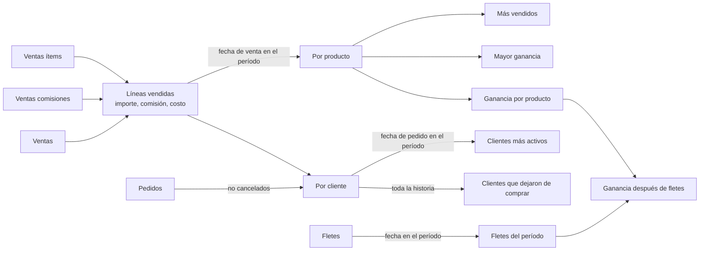
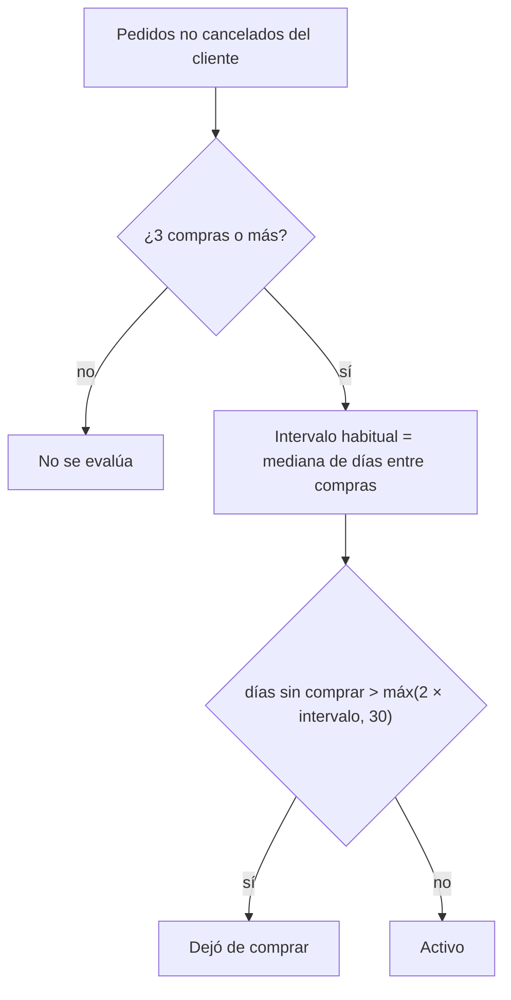

# Análisis

La pantalla **Análisis** cruza ventas, pedidos, comisiones y fletes para responder qué productos se venden
y rinden más, qué clientes compran más y qué clientes dejaron de comprar. Solo lee la planilla: no escribe
nada. Los cálculos están en [`src/dominio/analisis.ts`](../src/dominio/analisis.ts) (probados en `src/dominio/analisis.test.ts`) y la
pantalla en [`src/vistas/Analisis.tsx`](../src/vistas/Analisis.tsx). Los términos (venta, ítem, comisión,
flete asignado) son los de [modelo-de-datos.md](modelo-de-datos.md).

## Período

Se elige entre **3 meses**, **6 meses** (por defecto), **12 meses** y **Todo**. "N meses" va desde el mismo
día de N meses atrás a las 0:00 hasta hoy: el 16/10/2026, "3 meses" empieza el 16/07/2026.

Cada dato entra al período según su fecha:

| Dato | Fecha que se usa |
|---|---|
| Ítem vendido (importe, comisión, costo) | fecha de la venta (entrega) |
| Pedido de un cliente | fecha del pedido |
| Flete | fecha del flete |

Los **clientes que dejaron de comprar** no dependen del período: miran toda la historia (ver abajo).

## Productos

Para cada producto, sumando los ítems vendidos en el período:

- **Cantidad** = Σ `cantidad`, en la unidad del producto (`kg`, `unid.`).
- **Vendido** = Σ `importe`.
- **Comisiones** = Σ `monto` de las comisiones de esos ítems.
- **Costo** = Σ `cantidad × costo` (el costo guardado en el ítem al entregarlo).
- **Ganancia** = vendido − comisiones − costo, sumando solo los ítems **con costo**.
- **Margen** = ganancia / vendido de los ítems con costo.

Un ítem sin costo (venta de un producto que nunca se compró con precio) suma cantidad, vendido y
comisiones, pero no ganancia ni margen: no se puede saber cuánto dejó. La tabla lo marca como "N ventas sin
costo". Si todos los ítems de un producto están sin costo, su margen es "–" y no aparece en el gráfico de
mayor ganancia.

### Más vendido

Hay dos rankings, porque los kg y las unidades no se pueden sumar ni comparar:

- **Por importe:** todos los productos juntos, ordenados por vendido.
- **Por cantidad:** uno por unidad. El gráfico deja elegir la unidad ("Cantidad (kg)", "Cantidad (unid.)")
  y arriba se muestra el más vendido de cada una.

### Mayor ganancia

Dos órdenes: **Total** (ganancia en pesos) y **Margen %**. El margen sirve para ver qué conviene empujar; el
total, qué sostiene el negocio. Los gráficos muestran los 10 primeros; la tabla "Ganancia por producto"
muestra todos.

### Fletes

Los fletes **no se reparten entre productos ni pedidos**: son gasto de logística del mes. Un flete lleva
productos de distintos pedidos y a veces reposición sin pedido, y el transporte cobra por bulto o un precio fijo;
repartirlo por importe o por kilo sería arbitrario y movería la ganancia de un producto según con qué otros viajó.
Por eso la ganancia por producto (y por pedido) es **antes de fletes**, y los fletes se muestran aparte:

- **Fletes del período** = Σ `costo` de los fletes con fecha en el período.
- **Ganancia después de fletes** = Σ ganancia de productos − fletes del período.

El envío que se queda el vendedor tampoco cuenta: lo paga el cliente y va para él (ver "Envíos" en
[modelo-de-datos.md](modelo-de-datos.md)).

### Ejemplo

Período: últimos 6 meses al 16/10/2026. Hay un flete de $5.000 el 08/10.

| Producto | Ventas | Vendido | Comisiones | Costo | Ganancia | Margen |
|---|---|---|---|---|---|---|
| Avena | 3 × 10 kg a $800, costo $500 | $24.000 | $0 | $15.000 | $9.000 | 37,5 % |
| Almendras | 4 kg a $3.000, costo $1.500, comisión 10 % | $12.000 | $1.200 | $6.000 | $4.800 | 40 % |

Ganancia de productos $13.800, margen 38,3 %; después de fletes, $13.800 − $5.000 = $8.800. Más vendido
por importe: Avena. Por cantidad: Avena (30 kg); no hay ventas en unidades en el período.

## Clientes

Un cliente se identifica por el `contacto_id` del pedido y su nombre sale de *Contactos*; los pedidos sin
`contacto_id` no cuentan. Los pedidos **cancelados** (estado actual `cancelado`) no cuentan en ningún cálculo de clientes.

### Clientes más activos

Para cada cliente con pedidos o entregas en el período:

- **Pedidos** = cantidad de pedidos con fecha en el período.
- **Comprado** = Σ `importe` de los ítems de sus ventas con fecha en el período.
- **Último pedido** = fecha de su pedido más reciente (de toda la historia).

Se ordenan por pedidos, después por comprado, y se muestran los 20 primeros.

### Clientes que dejaron de comprar

Un cliente **dejó de comprar** si cumple las tres condiciones:

1. Tiene al menos **3 compras**: días distintos con pedidos (dos pedidos el mismo día son una compra).
   Con menos no hay un ritmo que comparar.
2. Su **intervalo habitual** es la mediana de los días entre compras consecutivas. Se usa la mediana y no
   el promedio para que una pausa larga aislada no lo estire.
3. Los **días sin comprar** (hoy − último pedido) superan **el doble del intervalo habitual y también 30
   días**. El mínimo de 30 días evita marcar a un cliente semanal por saltear dos semanas.

Se calcula con toda la historia hasta hoy, sin importar el período elegido, y se ordena por lo que compró
en total (los clientes más valiosos primero). Las constantes están en `INACTIVO` de `src/dominio/analisis.ts`.

### Ejemplos

Hoy: 16/10/2026.

| Cliente | Compras | Intervalo | Último pedido | Días sin comprar | Límite | Resultado |
|---|---|---|---|---|---|---|
| Bruno | 10/01, 09/02, 11/03, 10/04 | 30 | 10/04/2026 | 189 | 60 | dejó de comprar |
| Carla | 01/08, 01/09, 01/10 | 30,5 | 01/10/2026 | 15 | 61 | activa |
| Eva | 07/09, 14/09, 21/09 | 7 | 21/09/2026 | 25 | 30 | activa (el 22/10 pasa a inactiva) |
| Dani | 01/01/2025, 01/02/2025 | – | 01/02/2025 | 622 | – | no se evalúa (2 compras) |

## Preguntas abiertas

- **Clientes con pocas compras.** Un cliente que compró una o dos veces y no volvió no aparece como
  inactivo. Si interesa recuperarlos, se puede agregar una lista aparte ("compraron y no volvieron en N
  días").
- **Fletes por producto.** Si hiciera falta la ganancia por producto después de fletes, habría que elegir un
  criterio de reparto (por importe, por kilo o por bulto). Queda sin hacer hasta que se pida.
- **Umbrales.** 3 compras, el doble del intervalo y 30 días son un punto de partida; conviene revisarlos
  con los datos reales.
