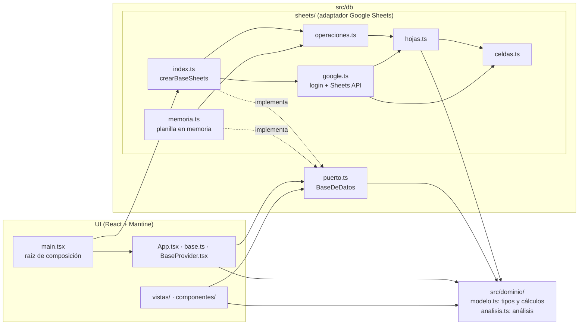
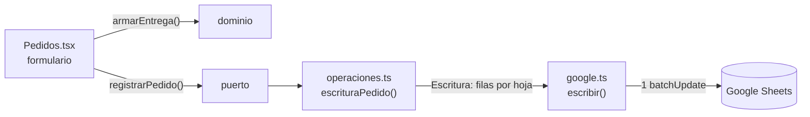

# Arquitectura

ERPeq separa en capas lo que es negocio, lo que es pantalla y lo que es guardar en la base (arquitectura
hexagonal, o de puertos y adaptadores). Hoy la única base es una planilla de Google Sheets, pero las
pantallas no lo saben: piden operaciones del negocio ("registrar un pedido") y el adaptador decide en qué
hojas y columnas se guarda.

## Capas



| Capa | Dónde | Qué tiene | Puede importar |
|---|---|---|---|
| Dominio | `src/dominio/` | Tipos (`Pedido`, `Venta`, `Flete`, `Cobro`…) y cálculos puros: stock por depósito, estados, precio vigente, comisiones, ganancia, armado de una entrega, IDs, saldo a cobrar de cada venta y cuentas entre socios (`modelo.ts`) y los análisis de ventas y clientes (`analisis.ts`). | Nada de fuera de su carpeta. |
| Puerto | `src/db/puerto.ts` | La interfaz `BaseDeDatos` (sesión, `leer()` y operaciones), los datos de cada operación y los errores `SinAcceso` y `SesionVencida`. | Solo el dominio. |
| Adaptador Google Sheets | `src/db/sheets/` | Hojas y columnas, lectura de filas, filas que agrega cada operación, celdas y fechas, login y Sheets API. | Dominio, puerto y `src/config.ts`. Nunca la UI. |
| UI | `src/App.tsx`, `src/base.ts`, `src/BaseProvider.tsx`, `src/vistas/`, `src/componentes/` | Pantallas y estado de la pantalla. Arma los objetos del dominio (con sus IDs) y llama al puerto. | Dominio y puerto. Nunca un adaptador. |
| Raíz de composición | `src/main.tsx` | Crea el adaptador (`crearBaseSheets(CONFIG)`) y se lo pasa a `App`. | Todo. |

ESLint hace cumplir las flechas con `no-restricted-imports` (bloques `capas/*` de `eslint.config.ts`): un
import que cruza una capa en la dirección prohibida no pasa `pnpm lint` ni el pre-commit.

## El puerto

`BaseDeDatos` junta tres partes:

- **Sesión:** `configurada`, `iniciar(alVencer)`, `ingresar()`, `salir()` y `abrir()`, que devuelve el
  título y la URL de la base y lo que le falta para la caja (`faltantes`: en Sheets, las hojas opcionales
  *Socios*, *Cobros* y *Rendiciones* que no existen, con sus encabezados), o lanza `SinAcceso` si la cuenta
  no puede abrirla. Una llamada con la sesión vencida lanza `SesionVencida` y avisa con `alVencer`.
  `iniciar` devuelve `true` si sigue vigente una sesión anterior (al recargar la página o en otra pestaña):
  la UI abre la base sin pasar por `ingresar()`. En Sheets, el token se guarda en `localStorage` hasta que
  vence; las pestañas lo comparten y, si una reconecta, las demás toman el token nuevo en su próxima llamada.
- **Lectura:** `leer()` devuelve todos los `Datos` del dominio; lo que está en `faltantes` se lee vacío.
  Los cálculos (stock, resúmenes de pedidos, cuentas entre socios) los hace la UI con las funciones del
  dominio.
- **Operaciones:** una por caso de uso. **Cada una es atómica**: se guarda entera o no se guarda. En Sheets
  es un solo `batchUpdate` con un `appendCells` por hoja.

| Operación | Datos | Hojas donde agrega filas (adaptador Sheets) |
|---|---|---|
| `registrarPedido` | `pedido`, `items`, `vendedores`, `momento`, `clienteNuevo`, `preciosNuevos`, `entrega`, `cobros` (opcional) | *Contactos* (si el cliente es nuevo), *Pedidos*, *Pedidos ítems*, *Pedidos estados* (`abierto`), *Pedidos vendedores*, *Precios* (productos sin precio de lista) y, en una venta directa, las de `registrarEntrega`. |
| `registrarEntrega` | `Entrega` (`venta`, `items`, `comisiones`) y `cobros` (opcional) | *Ventas*, *Ventas ítems*, *Ventas comisiones* (si hay), *Cobros* (si hay). |
| `cambiarEstadoPedido` | `pedidoId`, `cancelado` o `cerrado`, `momento` | *Pedidos estados*. |
| `registrarFlete` | `flete`, `items`, `estados`, `momento`, `pedidos`, `transporteNuevo` | *Contactos* (si el transporte es nuevo), *Fletes*, *Fletes ítems*, *Fletes estados* (uno por estado), *Pedidos fletes*. |
| `cambiarEstadoFlete` | `fleteId`, estado, `momento` | *Fletes estados*. |
| `registrarCompra` | `lineas`, `productosNuevos`, `proveedorNuevo` | *Productos* (nuevos), *Contactos* (si el proveedor es nuevo), *Compras* (el importe lo calcula el adaptador). |
| `registrarAjuste` | `Ajuste` | *Ajustes*. |
| `registrarPrecio` | `Precio` | *Precios*. |
| `registrarReglaComision` | `ReglaComision` | *Reglas de comisión*. |
| `registrarCobro` | `Cobro` | *Cobros*. |
| `registrarRendicion` | `Rendicion` | *Rendiciones*. |

Los IDs (`PE0003`, `V0004`, `C0012`…) los genera la UI con `siguienteId` del dominio a partir de los datos
leídos, así el mensaje de confirmación puede nombrarlos. El momento de los estados lo pasa la UI (`new Date()`).

## Ejemplo: venta directa

Ana (cliente nueva) pide 2 kg de Almendras a $3000 con el vendedor Leo (10%) y se le entrega en el momento.
La pantalla de Pedidos arma con el dominio el `Pedido` `PE0001`, su ítem y la entrega (`armarEntrega`
numera los ítems, calcula el importe de $6000 y la comisión de $600) y llama una sola vez a:

```ts
db.registrarPedido({ pedido, items, vendedores: ['VEN01'], momento, clienteNuevo, preciosNuevos: [], entrega })
```

El adaptador de Sheets lo traduce en un `batchUpdate` que agrega una fila en *Contactos*, *Pedidos*,
*Pedidos ítems*, *Pedidos estados*, *Pedidos vendedores*, *Ventas*, *Ventas ítems* y *Ventas comisiones*.
Si Google rechaza el pedido, no queda ninguna.



## Pruebas por capa

| Capa | Prueba |
|---|---|
| Dominio | `src/dominio/modelo.test.ts` y `src/dominio/analisis.test.ts` (Vitest), con objetos del dominio. |
| Adaptador Sheets | `src/db/sheets/*.test.ts` (Vitest): lectura de filas (`hojas.test.ts`), celdas y fechas (`celdas.test.ts`) y las filas exactas que agrega cada operación (`operaciones.test.ts`), sobre la planilla en memoria de `memoria.ts`, que usa las mismas hojas, columnas y lectura que el adaptador real. |
| Todo junto | `tests/` (Playwright): la app compilada contra Google simulado (`tests/google-falso.ts`), verificando las filas que llegan a cada `batchUpdate`. |

## Por qué carpetas y no un paquete

Se evaluó mover la base a un paquete de un workspace pnpm (`packages/db`). Para este repo (una sola app,
sin otros consumidores) agrega un `package.json`, un `tsconfig` y referencias de compilación más, y cambios en
el lockfile, sin dar un límite más fuerte: desde la app se podría seguir importando cualquier archivo del
paquete por ruta relativa, y haría falta ESLint igual. Las carpetas con reglas de ESLint dan el mismo límite
con menos piezas. `src/db/` tiene una sola entrada por adaptador (`sheets/index.ts`) y un puerto sin
dependencias fuera del dominio, así que pasarla a un paquete más adelante es mover carpetas.
