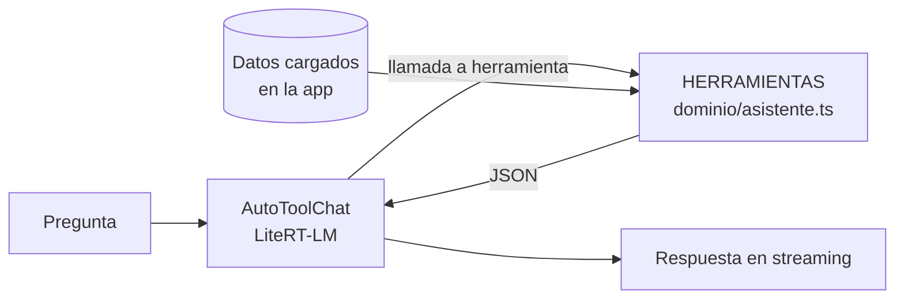

# Asistente

El asistente responde preguntas en lenguaje natural sobre los datos de la planilla ("¿cuánta almendra queda?",
"¿quién me debe plata?"). Corre entero en el dispositivo: los datos no se mandan a ningún servicio.

## Reglas

- **Solo consulta.** Sus herramientas leen los datos ya cargados en la app y no tienen acceso al puerto (`db`):
  no puede registrar, corregir ni borrar nada. Si se le pide, explica que se hace desde la pantalla.
- **Los números salen de las herramientas, no del modelo.** Cada herramienta usa los mismos cálculos del dominio
  que las pantallas (stock, saldos, ganancia), así que el asistente y la app dan los mismos números.
- **Nombres, nunca IDs.** Las herramientas devuelven productos, clientes y depósitos por nombre, y fechas
  `AAAA-MM-DD`.
- **Respuestas cortas.** Una lista de más de 20 filas se recorta y avisa cuántas hay (`{ filas, mostradas, total }`),
  porque todo entra en el contexto del modelo (4096 tokens).
- **Filtros por nombre.** `producto` y `cliente` buscan el texto dentro del nombre, sin tildes ni mayúsculas:
  "azucar" encuentra "Azúcar mascabo".

## Herramientas

| Herramienta | Parámetros | Devuelve |
|---|---|---|
| `consultar_stock` | `producto?` | Por producto: total, por depósito, en camino, comprometido, mínimo y si está bajo el mínimo. |
| `pedidos_abiertos` | `cliente?` | Pedidos pendientes o parciales: cliente, fecha, estado, depósito, importe y lo pendiente. |
| `ventas_a_cobrar` | `cliente?` | Ventas con saldo (importe, cobrado, saldo) y el total a cobrar. |
| `ventas_por_mes` | `meses?` (6) | Importe, comisión y ganancia por mes, del más reciente al más viejo. |
| `productos_mas_vendidos` | `periodo?`: `3`, `6`, `12` o `todo` (3) | Productos por importe vendido, con cantidad, ganancia y margen. |
| `clientes_inactivos` | — | Los de `spec/analisis.md`: último pedido, días sin comprar, cada cuántos días compraba. |
| `precios` | `producto?` | Precio de lista y costo vigentes hoy. |

Ejemplo: Ana pidió 10 kg de almendras a $1000 y se le entregaron 4; pagó $1500. Entraron 30 kg por compra.

- `consultar_stock({ producto: "almen" })` → total 26, comprometido 6 (lo que falta entregarle a Ana).
- `ventas_a_cobrar()` → total 2500: la entrega de $4000 menos los $1500 cobrados.

## Cómo corre

- **Modelo:** Gemma 4 E2B en formato `.litertlm` para GPU, de `litert-community` en Hugging Face, fijado a un
  commit. Pesa ~2 GB. La primera vez se descarga y se guarda en Cache Storage (`erpeq-modelo`); cambiar la URL
  borra la versión anterior al descargar la nueva.
- **Motor:** `@litert-lm/core` sobre WebGPU. Sin WebGPU, el panel avisa y no ofrece activar. El WASM del motor
  (~24 MB) lo baja la librería de jsDelivr, en la versión instalada.
- **Agente:** `AutoToolChat` de la librería: el modelo pide herramientas con su formato nativo, la librería las
  ejecuta y le devuelve el resultado hasta que responde con texto. El prefacio le dice la fecha de hoy, que responda
  en español y que no invente números.
- **Datos:** las herramientas leen los datos del momento de cada pregunta (si la planilla se relee, la próxima
  pregunta ya los ve).
- El panel se carga aparte (`lazy`) la primera vez que se abre, y el modelo solo cuando se toca *Activar*: quien
  no usa el asistente no descarga nada.
