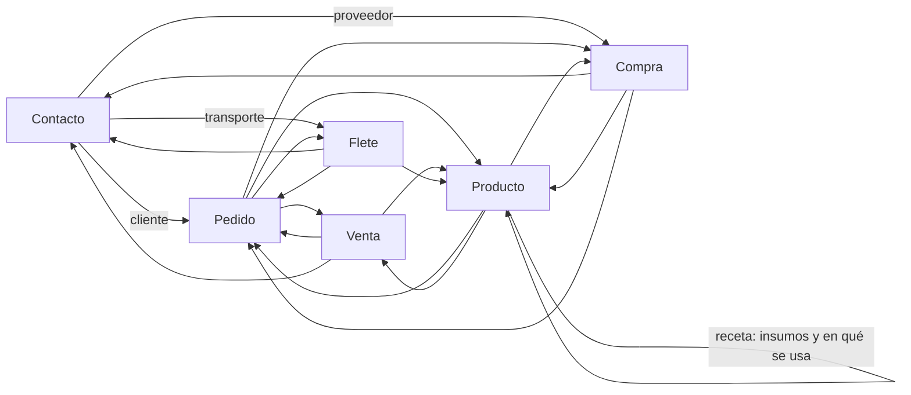

# Fichas

Tocar una fila de una tabla abre la **ficha** de lo que representa: un modal con sus datos y vínculos a lo que tiene
relacionado. Tocar un vínculo abre esa otra ficha encima; **Volver a …** regresa a la anterior y cerrar el modal
(✕, Escape o tocar afuera) las cierra todas. En celular el modal ocupa toda la pantalla.

Los cálculos están en `src/dominio/fichas.ts` (puro, con pruebas en `fichas.test.ts`); el modal y el contenido de
cada ficha, en `src/componentes/Fichas.tsx`.

## Qué fila abre qué

| Pantalla | Tabla | Ficha |
|---|---|---|
| Stock | Inventario | Producto |
| Pedidos | Pedidos | Pedido |
| Ventas | Detalle del mes | Venta (la de esa línea) |
| Compras | Detalle del mes | Compra |
| Fletes | Fletes | Flete |
| Precios | Lista de precios | Producto |
| Recetas | Lista de recetas | Producto que sale |
| Caja | Ventas a cobrar | Venta |
| Análisis | Ganancia por producto; clientes más activos y que dejaron de comprar | Producto; Contacto |

Los botones, vínculos y campos de una fila (Entregar, Cobrar, Despachar…) hacen lo suyo y no abren la ficha; tampoco
la abre seleccionar texto. Para el teclado y los lectores de pantalla, el texto principal de la fila (cliente,
producto, transporte o proveedor) es un vínculo que abre la misma ficha.

## Qué muestra cada ficha

| Ficha | Datos | Vínculos y listas | Acción |
|---|---|---|---|
| **Pedido** | Cliente, fecha, depósito de entrega, estado, vendedores, nota; importe, entregado y ganancia | Productos (con lo entregado y pendiente), entregas (con lo que falta cobrar de cada una), fletes asignados (con su costo) y compras hechas para el pedido | *Registrar entrega* (si está abierto): abre Pedidos con ese pedido elegido |
| **Venta** | Cliente, pedido, fecha, depósito, comisión por vendedor, nota; importe, cobrado, a cobrar y ganancia | Productos entregados (con costo y ganancia de cada uno) y cobros | — |
| **Producto** | Unidad, precio de lista vigente hoy, costo promedio, mínimo | Stock por depósito (en depósito, en camino, en fletes en preparación y comprometido), receta activa que lo fabrica, recetas activas que lo usan, pedidos abiertos con algo pendiente, ventas y compras | — |
| **Contacto** | Tipo, teléfono, dirección, email, localidad, observaciones (los vacíos no se muestran) | Como cliente: cantidad de pedidos, lo comprado (entregado), lo que debe y sus pedidos. Como proveedor: sus compras. Como transporte: sus fletes | — |
| **Flete** | Transporte, fecha, recorrido, estado, costo, guía, nota | Mercadería, pedidos (con el costo asignado) y los estados por los que pasó | *Ver en Fletes*: abre Fletes con la fila resaltada |
| **Compra** | Proveedor, producto, fecha, depósito, cantidad, precio, importe, remito, nota | Pedido para el que se compró | — |

- Las listas van de lo más reciente a lo más viejo. Las de ventas, compras, pedidos de un cliente y fletes de un
  transporte muestran las 10 últimas y avisan cuántas más hay.
- El título del modal nombra lo que se ve sin IDs, como el resto de la app: "Pedido de Ana · 10/10/26", "Venta a
  Ana · 05/10/26", "Flete de Interprovincial · 08/10/26", "Producto: Almendras", "Cliente: Ana", "Compra a Prov A ·
  02/10/26". Una compra no tiene ID: la ficha la identifica por su número de fila en *Compras*.
- La ganancia de una venta es importe − comisiones − cantidad × costo de cada ítem; si algún ítem no tiene costo, no
  se muestra.

## Ejemplo

Con los datos de prueba (`tests/google-falso.ts`), tocar en Ventas la venta de Ana del 05/10 muestra 4 kg de
almendras a $ 3.000 = $ 12.000, la comisión de Leo ($ 1.200), $ 12.000 a cobrar y una ganancia de
12.000 − 1.200 − 4 × 1.500 = $ 4.800. Desde ahí:

1. **Ana · 05/10/26** abre el pedido, ya entregado (sin *Registrar entrega*).
2. **Ana** abre la cliente: localidad Funes, Santa Fe; dos pedidos y $ 12.000 a cobrar.
3. **10/10/26** abre el otro pedido, pendiente; **Avena** muestra 25 kg en Rosario con 10 comprometidos.
4. **Volver a Pedido de Ana · 10/10/26** y *Registrar entrega* abren Pedidos con ese pedido para entregarlo.
