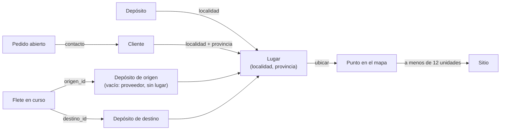

# Mapa de Inicio

La pantalla Inicio muestra un mapa de Argentina con tres cosas:

- **Depósitos**: un ícono en la localidad de cada depósito. Tocarlo abre Stock filtrado por ese depósito
  (selector *Mostrar depósito* de la tabla *Stock por depósito*: solo el grupo de ese depósito). Ver `spec/stock.md`.
- **Pedidos pendientes**: un globito con la cantidad de pedidos abiertos (pendientes o parciales) de clientes
  de esa localidad. Es naranja y pasa a rojo si alguno tiene faltante de stock. Tocarlo muestra los pedidos;
  tocar uno abre Pedidos con ese pedido elegido para entregarlo.
- **Fletes en curso**: una línea curva con flecha del origen al destino, punteada amarilla si está en
  preparación y azul si está en camino (si en un tramo hay de los dos, azul). Tocar la línea o el camión del
  medio muestra los fletes del tramo; tocar uno abre Fletes con esa fila resaltada.

El mapa no usa servicios externos ni teselas: es un SVG con las provincias y una tabla de localidades que vienen
con la app (`src/mapa/argentina.json`). Inicio lo carga aparte (`React.lazy`) porque pesa ≈ 150 KB (≈ 57 KB
comprimido).

## Zona de los depósitos

El mapa arranca recortado a la **zona de los depósitos**: el rectángulo que encierra a todos los depósitos
ubicados, con 30 unidades (≈ 165 km) de margen y al menos 120 unidades (≈ 650 km) de lado, sin salirse del país
(`zona` de `src/mapa/ubicar.ts`). Un botón con lupa arriba a la derecha de la tarjeta alterna entre la zona
(*Alejar a todo el país*) y el país entero (*Acercar a la zona de los depósitos*); queda siempre en el mismo
lugar, aunque el mapa cambie de proporción. Si no hay ningún depósito ubicado, se ve el país entero y no hay
botón.

Con el mapa recortado, lo que queda fuera de la zona (un pedido de Córdoba, por ejemplo) no se ve hasta alejar.

Ejemplo: con depósitos en Rosario (211, 229), Bahía Blanca (185, 344) y Mar del Plata (259, 330), la zona va de
x = 185 − 30 = 155 a 259 + 30 = 289 (134 de ancho) y de y = 229 − 30 = 199 a 344 + 30 = 374 (175 de alto). Con
los datos de prueba (solo Rosario y Bahía Blanca) el ancho daría 86 y se lleva al mínimo de 120.

## Qué va en el mapa y dónde

`marcasDelMapa` (`src/dominio/mapa.ts`) decide qué se muestra y en qué lugar:

| Marca | Cuáles | Lugar |
|---|---|---|
| Depósito | Todos los que tienen localidad. | `localidad` del depósito (puede traer la provincia: "Rosario, Santa Fe"). |
| Pedido | Los abiertos (`pendiente` o `parcial`). | `localidad` y `provincia` del cliente. |
| Flete | Los en curso (`preparacion` o `camino`). | Origen: el depósito de origen; si está vacío viene de un proveedor y no tiene lugar. Destino: el depósito de destino; si está vacío va a un cliente y no tiene lugar (un flete no sabe para qué pedidos va). |

## Ubicar una localidad

`ubicar` (`src/mapa/ubicar.ts`) busca la localidad en las 4.027 localidades censales del INDEC:

1. Compara sin tildes, mayúsculas, signos ni espacios de más ("bahia  blanca" = "Bahía Blanca").
2. Acepta otros nombres de la Ciudad de Buenos Aires: "CABA", "Capital Federal", "Capital", "Ciudad de Buenos
   Aires" y "Buenos Aires" como localidad. Como provincia también acepta "Bs As" y "Tierra del Fuego".
3. Si el nombre está en varias provincias (hay 13 "San Pedro"), usa la provincia del lugar. Si no la tiene o no
   coincide, elige la de mayor rango: +1 si se llama como su departamento o municipio y +1 si es parte de un
   aglomerado (por ejemplo, "Córdoba" de Córdoba tiene rango 2).
4. Si no la encuentra, el depósito, pedido o flete se lista debajo del mapa en "Fuera del mapa".

Ejemplos con los datos de prueba:

| Lugar | Resultado |
|---|---|
| Depósito *General*, "Bahía Blanca" | Bahía Blanca, Buenos Aires. |
| Depósito *Rosario*, "Rosario" | Rosario, Santa Fe (la única localidad con ese nombre exacto). |
| Cliente Ana, "Funes", "Santa Fe" | Funes, Santa Fe: a 3 unidades de Rosario. |
| "San Pedro", "Misiones" | San Pedro de Misiones, no el de Jujuy ni el de Buenos Aires. |
| "Ciudad Gótica" | Fuera del mapa. |

## Sitios y tramos

Lugares a menos de 12 unidades del mapa (≈ 65 km) se juntan en un **sitio** para que sus marcas no se tapen:
Ana (Funes) y el depósito Rosario quedan en el sitio "Rosario · Funes", con el ícono del depósito y el globito
"1". El sitio queda en el primer lugar agregado; los depósitos se agregan primero, así el ícono queda en su
lugar exacto.

Los fletes con el mismo sitio de origen y de destino forman un **tramo** (una sola línea). Un flete cuyo origen
o destino no se pudo ubicar, o que va dentro del mismo sitio (de Rosario a Funes), queda en "Fuera del mapa".

En los datos de prueba, F0001 (General → Rosario, en camino) es una línea azul de Bahía Blanca a "Rosario ·
Funes" con un camión en el medio.

## Proyección y datos

`herramientas/mapa_argentina.py` baja las provincias (IGN, `infra.datos.gob.ar/georef/provincias.geojson`) y
las localidades censales (INDEC, API Georef), las proyecta y escribe `src/mapa/argentina.json`:

- Proyección equirectangular centrada en 38° S: `x = (lon + 74) · cos 38° · 20`, `y = (−21,5 − lat) · 20`.
  El mapa mide 331 × 690 unidades.
- Las provincias se simplifican con Douglas-Peucker (tolerancia 0,6 unidades, ≈ 3 km); las islas que quedan con
  menos de tres puntos se descartan. Se deja afuera lo que está al sur de 56° S (Antártida) y al este de 53° O
  (Georgias y Sandwich del Sur); las Malvinas quedan.
- Cada localidad es `[nombre, índice de provincia, x, y, rango]`.

Para actualizar los datos: `python3 herramientas/mapa_argentina.py` (sin dependencias).
