# Modelo de datos

Especificación del modelo de datos de ERPeq sobre Google Sheets: una hoja por tabla, primera fila con
encabezados, una fila por registro.

Los tipos y cálculos están en [src/dominio/modelo.ts](../src/dominio/modelo.ts); las hojas, columnas,
lectura y filas a escribir, en [src/db/sheets/hojas.ts](../src/db/sheets/hojas.ts) y
[src/db/sheets/operaciones.ts](../src/db/sheets/operaciones.ts) (ver [arquitectura.md](arquitectura.md)).
Sus ideas centrales:

1. **Pedidos y ventas son entidades distintas.** El pedido es lo que pide el cliente; la venta es la entrega
   en la ciudad de destino. Un pedido puede entregarse en varias ventas.
2. Pedidos y ventas tienen varios productos (cabecera + ítems). El precio se fija al crear el pedido, con
   el último precio de lista o uno especial, y no cambia hasta la entrega.
3. Las comisiones dependen del vendedor y del producto, se generan al entregar (en la venta) y un pedido
   puede comisionar a más de un vendedor. El porcentaje de la regla se puede cambiar en cada entrega.
4. Los fletes se asocian a pedidos (uno o varios fletes por pedido, uno o varios pedidos por flete).
5. Los fletes entre depósitos mueven stock y tienen estados: en preparación, en camino y finalizado.
6. Cada venta registra sus **cobros**: cuánto, en efectivo o por transferencia y qué socio recibió la plata.
   Con eso y las comisiones se calcula cuánto le debe cada socio al dueño de la mercadería (o al revés).

## Flujo típico

Llega un pedido. Si no hay stock suficiente en el depósito de entrega, se compra y/o se manda mercadería
con un flete desde otro depósito. Cuando la mercadería está, se entrega al cliente en la ciudad de destino:
esa entrega es la venta, descuenta el stock y genera la comisión.

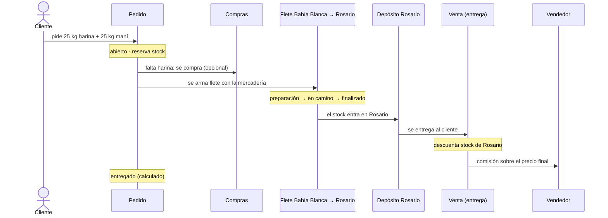

## Principios

- **Solo se agregan filas.** Nada se edita ni se borra: las correcciones son filas nuevas (un ajuste, un
  nuevo estado). Así la planilla funciona como un historial y el stock se puede recalcular siempre.
- **Lo derivado se calcula.** El stock, lo pendiente de un pedido, el estado actual de un flete y el costo
  promedio salen de los movimientos. Lo único que se guarda calculado es lo que tiene que quedar fijo al
  momento de la operación (precio, costo, porcentaje de comisión): si después cambia el costo promedio o una
  regla de comisión, las ventas pasadas no cambian.
- **Valores por defecto que se pueden sobreescribir.** *Precios* y *Reglas de comisión* guardan los valores
  por defecto. Cada pedido o entrega guarda el valor por defecto que se propuso y el que se usó (ver
  [Valores por defecto y sobreescritura](#valores-por-defecto-y-sobreescritura)).
- **Referencias por ID.** Cada tabla tiene un ID con prefijo: `P001` (producto), `C0001` (contacto), `VEN01`
  (vendedor), `SOC01` (socio), `PE0001` (pedido), `V0001` (venta), `F0001` (flete); los depósitos usan códigos cortos (`BB`,
  `ROS`). La app genera el siguiente al mayor existente.
- **Los nombres viven en una sola hoja.** Las filas que apuntan a un producto, contacto, vendedor o socio
  guardan solo su ID; el nombre (y el tipo, la localidad y la provincia de un cliente) sale de *Productos*,
  *Contactos*, *Vendedores* o *Socios*. Corregir un nombre en esa hoja lo corrige en todas las pantallas.
  Un ID que no está en su hoja se muestra tal cual.
- **Una operación, un `batchUpdate`.** Un pedido o una venta escribe cabecera, ítems y filas relacionadas en
  varias hojas (y, si hace falta, el contacto o el producto nuevo). Se manda todo en un solo
  `spreadsheets.batchUpdate` con `appendCells`, que la API aplica completo o no aplica nada, así no quedan
  operaciones a medio escribir. Los textos se guardan como texto, las fechas como fecha (`dd/mm/aaaa`) y los
  estados con fecha y hora.
- **Estado actual = última fila.** En *Pedidos estados* y *Fletes estados*, el estado vigente es el de la
  última fila agregada para ese ID.

## Diagrama entidad-relación

```mermaid
erDiagram
    DEPOSITO ||--o{ COMPRA : recibe
    DEPOSITO ||--o{ PEDIDO : "entrega desde"
    DEPOSITO ||--o{ VENTA : despacha
    DEPOSITO ||--o{ AJUSTE : corrige
    DEPOSITO |o--o{ FLETE : "origen"
    DEPOSITO |o--o{ FLETE : "destino"

    PRODUCTO ||--o{ COMPRA : ""
    PRODUCTO ||--o{ PEDIDO_ITEM : ""
    PRODUCTO ||--o{ VENTA_ITEM : ""
    PRODUCTO ||--o{ AJUSTE : ""
    PRODUCTO ||--o{ FLETE_ITEM : ""
    PRODUCTO |o--o{ REGLA_COMISION : "aplica a"
    PRODUCTO ||--o{ PRECIO : "lista"

    CONTACTO ||--o{ PEDIDO : "cliente"
    CONTACTO |o--o{ COMPRA : "proveedor"
    CONTACTO |o--o{ FLETE : "transporte"
    TIPO_CLIENTE ||--o{ CONTACTO : clasifica

    PEDIDO ||--|{ PEDIDO_ITEM : contiene
    PEDIDO ||--|{ PEDIDO_ESTADO : historial
    PEDIDO ||--o{ PEDIDO_VENDEDOR : ""
    VENDEDOR ||--o{ PEDIDO_VENDEDOR : ""
    PEDIDO |o--o{ COMPRA : "motiva"

    PEDIDO ||--o{ VENTA : "se entrega en"
    VENTA ||--|{ VENTA_ITEM : contiene
    PEDIDO_ITEM ||--o{ VENTA_ITEM : "entregado en"
    VENTA_ITEM ||--o{ VENTA_COMISION : genera
    VENDEDOR ||--o{ VENTA_COMISION : cobra
    VENDEDOR ||--o{ REGLA_COMISION : tiene

    PEDIDO ||--o{ PEDIDO_FLETE : ""
    FLETE ||--o{ PEDIDO_FLETE : ""
    FLETE ||--o{ FLETE_ITEM : transporta
    FLETE ||--|{ FLETE_ESTADO : historial

    VENTA ||--o{ COBRO : "se cobra en"
    SOCIO ||--o{ COBRO : recibe
    SOCIO |o--o{ VENDEDOR : "se le acreditan las comisiones de"
    SOCIO ||--o{ RENDICION : entrega
    SOCIO ||--o{ RENDICION : recibe

    VENTA ||--o| VENTA_ENVIO : "cobra"
    VENDEDOR |o--o{ VENTA_ENVIO : "se queda con"
    REGLA_ENVIO ||..o{ VENTA_ENVIO : "propone"

    PRODUCTO ||--o{ RECETA : "sale de"
    RECETA ||--o{ RECETA_ITEM : "lleva (por versión)"
    PRODUCTO ||--o{ RECETA_ITEM : "insumo"
    RECETA ||--o{ AJUSTE : "se fabrica con (motivo)"

    DEPOSITO {
        string id PK "BB, ROS"
        string nombre "General, Rosario"
        string localidad
    }
    PRODUCTO {
        string id PK "P001"
        string producto
        string unidad "kg, u, lt"
        number minimo
    }
    CONTACTO {
        string id PK "C0001"
        string rol "cliente, proveedor, transporte"
        string nombre
        string tipo_cliente FK
        string localidad
        string provincia
    }
    TIPO_CLIENTE {
        string tipo PK "DIETETICA, MAYORISTA..."
    }
    VENDEDOR {
        string id PK "VEN01"
        string nombre "Guada/Hernán"
        boolean activo
        string localidad "Rosario"
    }
    REGLA_COMISION {
        string vendedor_id FK
        string producto_id FK "vacío = todos"
        number porcentaje
        date desde
    }
    PRECIO {
        string producto_id FK
        number precio
        date desde
    }
    COMPRA {
        date fecha
        string deposito_id FK
        string contacto_id FK "proveedor"
        string producto_id FK
        number cantidad
        number precio
        string pedido_id FK "opcional"
    }
    PEDIDO {
        string id PK "PE0001"
        date fecha
        string contacto_id FK
        string deposito_id FK "desde dónde se entrega"
        string nota
    }
    PEDIDO_ITEM {
        string pedido_id FK
        number linea
        string producto_id FK
        number cantidad
        number precio_lista "por defecto (copia)"
        number precio "el que se usó"
    }
    PEDIDO_ESTADO {
        string pedido_id FK
        datetime fecha
        string estado "abierto, cancelado, cerrado"
    }
    PEDIDO_VENDEDOR {
        string pedido_id FK
        string vendedor_id FK
    }
    VENTA {
        string id PK "V0001"
        date fecha "día de entrega"
        string pedido_id FK
        string deposito_id FK
        string nota
    }
    VENTA_ITEM {
        string venta_id FK
        number linea
        number pedido_linea FK
        string producto_id FK
        number cantidad
        number precio "copia del pedido"
        number importe
        number costo "costo promedio al entregar"
    }
    VENTA_COMISION {
        string venta_id FK
        number linea FK
        string vendedor_id FK
        number porcentaje_regla "por defecto (copia)"
        number porcentaje "el que se usó"
        number monto
    }
    FLETE {
        string id PK "F0001"
        date fecha
        string contacto_id FK "transporte"
        string origen_id FK "depósito; vacío = proveedor"
        string destino_id FK "depósito; vacío = cliente"
        number costo
        string guia
    }
    FLETE_ITEM {
        string flete_id FK
        string producto_id FK
        number cantidad
    }
    FLETE_ESTADO {
        string flete_id FK
        datetime fecha
        string estado "preparacion, camino, finalizado, cancelado"
    }
    PEDIDO_FLETE {
        string pedido_id FK
        string flete_id FK
        number costo_asignado
    }
    AJUSTE {
        date fecha
        string deposito_id FK
        string producto_id FK
        number cantidad "+/-"
        string motivo "o Fabricación FA0001 (RE0001 v1)"
    }
    SOCIO {
        string id PK "SOC01"
        string nombre "Sampatti, Guada/Hernán"
        string vendedor_id FK "una fila por vendedor"
        string rol "dueño, socio"
    }
    COBRO {
        date fecha
        string venta_id FK
        number importe
        string medio "efectivo, transferencia"
        string socio_id FK "quién recibió la plata"
        string nota
    }
    RENDICION {
        date fecha
        string de_socio_id FK
        string a_socio_id FK
        number importe
        string medio "efectivo, transferencia"
        string nota
    }
    REGLA_ENVIO {
        number minimo "sin cargo desde"
        number costo
        date desde
    }
    VENTA_ENVIO {
        string venta_id FK
        string vendedor_id FK "vacío = el negocio"
        number costo_regla "por defecto (copia)"
        number costo "el que se cobró"
    }
    RECETA {
        string id PK "RE0001 (con version)"
        number version PK "1, 2, ..."
        date desde
        string producto_id FK "lo que sale"
        number cantidad "sale por tanda"
        string activa "sí, no"
    }
    RECETA_ITEM {
        string receta_id FK
        number version FK
        string producto_id FK "insumo"
        number cantidad "por tanda"
    }
```

## Tablas (hojas)

Las columnas se listan en el orden de la hoja. **(c)** indica un valor copiado al momento de la operación
(precio, costo, porcentaje), que no cambia aunque después cambie su origen. Los nombres no se copian: las
columnas `*_id` apuntan a la hoja donde están.

La fila 1 de cada hoja tiene los encabezados. La app los compara con los que espera (sin distinguir
mayúsculas; puede haber columnas de más a la derecha) y, si no coinciden, no lee ni escribe nada: con las
columnas corridas guardaría cada dato en otra columna.

### Maestros

| Hoja | Columnas | Notas |
|---|---|---|
| **Depósitos** | `id`, `nombre`, `localidad` | `BB` General (Bahía Blanca) y `ROS` Rosario. |
| **Productos** | `id`, `producto`, `unidad`, `minimo` | El stock no se guarda: lo calcula la app. |
| **Contactos** | `id`, `rol`, `nombre`, `tipo_cliente`, `telefono`, `direccion`, `email`, `localidad`, `provincia`, `observaciones` | `rol`: `cliente`, `proveedor` o `transporte`. Los clientes se cargan a mano en la hoja: el pedido solo elige uno que ya existe. La app agrega el contacto cuando se carga un proveedor o transporte nuevo. |
| **Tipos de cliente** | `tipo` | Lista de tipos para la columna `tipo_cliente` de *Contactos*. |
| **Vendedores** | `id`, `nombre`, `activo`, `localidad` | Quien consigue el pedido y cobra comisión. "Guada/Hernán" es **un** vendedor; "Leo" es otro. `activo` vacío o "sí" = se puede elegir. `localidad`: donde trabaja; se lo propone en los pedidos de clientes de esa localidad (ver [Pedidos](#pedidos)). |
| **Precios** | `producto_id`, `precio`, `desde` | Precio por defecto, con historial. Un cambio de precio es una fila nueva; el vigente es el de `desde` más reciente. |
| **Reglas de comisión** | `vendedor_id`, `producto_id`, `porcentaje`, `desde` | Porcentaje por defecto. `producto_id` vacío = regla general del vendedor. |

### Pedidos y ventas

| Hoja | Columnas | Notas |
|---|---|---|
| **Pedidos** | `id`, `fecha`, `contacto_id`, `deposito_id`, `nota` | `deposito_id` es el depósito desde el que se va a entregar. El cliente, su tipo y su localidad salen del contacto. |
| **Pedidos ítems** | `pedido_id`, `linea`, `producto_id`, `cantidad`, `precio_lista` (c), `precio` | `precio_lista` es el de *Precios* al crear el pedido (vacío si no había); `precio` es el que se usa. Si difieren, es un precio especial. |
| **Pedidos estados** | `pedido_id`, `fecha`, `estado` | `abierto` al crearlo; después solo los estados que se deciden a mano (ver [Estados del pedido](#estados-del-pedido)). |
| **Pedidos vendedores** | `pedido_id`, `vendedor_id` | Quiénes comisionan por este pedido. Comisionan por todas sus líneas. |
| **Ventas** | `id`, `fecha`, `pedido_id`, `deposito_id`, `nota` | Una entrega. El cliente sale del pedido. |
| **Ventas ítems** | `venta_id`, `linea`, `pedido_linea`, `producto_id`, `cantidad`, `precio` (c), `importe`, `costo` (c) | Lo entregado de cada línea del pedido. `costo` es el costo promedio unitario al entregar. |
| **Ventas comisiones** | `venta_id`, `linea`, `vendedor_id`, `porcentaje_regla` (c), `porcentaje`, `monto` | Una fila por ítem entregado y vendedor. `porcentaje_regla` es el que propone la regla; `porcentaje` el que se usó. `monto = importe × porcentaje / 100`. |

### Stock y logística

| Hoja | Columnas | Notas |
|---|---|---|
| **Compras** | `fecha`, `deposito_id`, `contacto_id`, `producto_id`, `cantidad`, `precio`, `importe`, `remito`, `pedido_id`, `nota` | `contacto_id` es el proveedor. `pedido_id` opcional: la compra se hizo para un pedido. No cambia el cálculo de stock. |
| **Fletes** | `id`, `fecha`, `contacto_id`, `origen_id`, `destino_id`, `costo`, `guia`, `nota` | `contacto_id` es el transporte. `origen_id` / `destino_id` son depósitos; vacío = afuera (proveedor o cliente). |
| **Fletes ítems** | `flete_id`, `producto_id`, `cantidad` | Solo para mercadería que va **entre depósitos**. |
| **Fletes estados** | `flete_id`, `fecha`, `estado` | Cada cambio de estado es una fila nueva. El estado actual es el de la última fila. Un flete que se carga ya despachado o terminado escribe también los estados anteriores. |
| **Pedidos fletes** | `pedido_id`, `flete_id`, `costo_asignado` | Une pedidos y fletes (N a N). `costo_asignado` es la parte del flete que se carga a ese pedido. |
| **Ajustes** | `fecha`, `deposito_id`, `producto_id`, `cantidad`, `motivo` | Correcciones de stock (roturas, conteos) y fabricaciones: una fila negativa por insumo y una positiva por el producto, con `motivo` = "Fabricación FA0001 (RE0001 v1)" (ID de la fabricación, receta y versión). |

### Recetas

También son **opcionales**: si faltan, la pantalla Recetas avisa cuáles crear y no deja guardar recetas ni
fabricar. Las fabricaciones no tienen hoja propia: son filas de *Ajustes*. El detalle está en [recetas.md](recetas.md).

| Hoja | Columnas | Notas |
|---|---|---|
| **Recetas** | `id`, `version`, `desde`, `producto_id`, `cantidad`, `activa` | Una fila por versión. `producto_id` es lo que sale: un producto de *Productos* con precio de lista. Cambiar una receta o darla de baja agrega una versión nueva; la vigente es la de `desde` más reciente (y, a igual fecha, la de `version` más alta). `cantidad` es lo que sale de una tanda, en la unidad del producto, con la merma descontada. `activa`: vacío o `sí`, o `no` si se dio de baja. |
| **Recetas ítems** | `receta_id`, `version`, `producto_id`, `cantidad` | Insumos de cada versión, por tanda, en la unidad de cada producto. |

### Caja

Estas tres hojas son **opcionales**: si la planilla no las tiene, la app las lee vacías, la pantalla Caja
avisa cuáles crear y no deja registrar cobros ni rendiciones (ver `OPCIONALES` en `src/db/sheets/hojas.ts`;
el puerto lo informa en `InfoBase.faltantes`). Las demás hojas
son obligatorias: si falta una, la lectura falla.

| Hoja | Columnas | Notas |
|---|---|---|
| **Socios** | `id`, `nombre`, `vendedor_id`, `rol` | Entre quiénes se reparte la plata. `vendedor_id` es un vendedor cuyas comisiones se le acreditan al socio; un socio con varios vendedores tiene una fila por vendedor (con el mismo `id`; el nombre sale de la primera). `rol`: `dueño` para el dueño de la mercadería (uno solo) y `socio` para los demás. |
| **Cobros** | `fecha`, `venta_id`, `importe`, `medio`, `socio_id`, `nota` | Lo que pagó el cliente por una venta. Una venta puede tener varios cobros (pagos parciales o mezcla de medios). `medio`: `efectivo` o `transferencia`. `socio_id` es quien recibió la plata (en mano o en su cuenta). |
| **Rendiciones** | `fecha`, `de_socio_id`, `a_socio_id`, `importe`, `medio`, `nota` | Plata que un socio le entrega a otro para saldar la cuenta: un socio que le rinde al dueño lo cobrado, o el dueño que le paga a un socio sus comisiones. |

### Envíos

También son **opcionales**: si faltan, la pantalla Precios avisa cuáles crear y las entregas no cobran envío.
El detalle está en [Envíos](#envíos).

| Hoja | Columnas | Notas |
|---|---|---|
| **Envíos** | `minimo`, `costo`, `desde` | Costo de envío vigente desde `desde`: los pedidos por menos de `minimo` pagan `costo`. Un `costo` de 0 deja de cobrarlo. Una fila sin `costo` no se lee. |
| **Ventas envíos** | `venta_id`, `vendedor_id`, `costo_regla` (c), `costo` | Envío de una entrega (a lo sumo una fila por venta). `vendedor_id`: quien hizo la entrega y se queda con el envío; vacío si es para el negocio. `costo_regla` es el que propuso *Envíos*; `costo`, el que se cobró. |

## Valores por defecto y sobreescritura

El precio de un pedido y el porcentaje de comisión de una entrega tienen un valor por defecto, que se
mantiene en una tabla, y se pueden cambiar en cada operación. La fila de la operación guarda los dos: el
que se propuso y el que se usó. Así se ve qué operaciones tuvieron un valor especial, y cambiar la tabla no
modifica lo ya cargado.

| Valor | Tabla por defecto | Se propone en | Se guarda en | Por defecto (copia) | Usado |
|---|---|---|---|---|---|
| Precio unitario | *Precios* (vigente a la fecha del pedido) | Nuevo pedido | *Pedidos ítems* | `precio_lista` | `precio` |
| % de comisión | *Reglas de comisión* (vigente a la fecha de la entrega) | Registrar entrega | *Ventas comisiones* | `porcentaje_regla` | `porcentaje` |
| Costo de envío | *Envíos* (vigente a la fecha de la entrega) | Registrar entrega | *Ventas envíos* | `costo_regla` | `costo` |

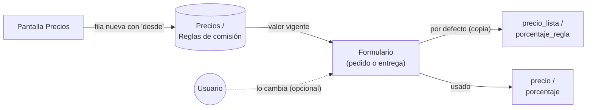

- Los valores por defecto se cambian desde la pantalla **Precios** de la app (o agregando filas a mano):
  cada cambio es una fila nueva con su fecha `desde`.
- La app marca los precios especiales al cargar el pedido ("Precio especial (lista $X)") y los porcentajes
  distintos de la regla al cargar la entrega ("(regla X%)"). En *Ventas*, la liquidación de comisiones
  indica cuántas entregas tuvieron un porcentaje distinto de la regla.
- Si un producto no tiene precio de lista, el precio del pedido se agrega a *Precios* (con `desde` = fecha
  del pedido) y `precio_lista` queda vacío.

## Pedidos

El pedido registra lo que pidió el cliente y a qué precio. **No mueve stock**: lo reserva. Se puede crear
aunque no haya stock: lo que falta aparece en `faltante` (ver [Cálculo de stock](#cálculo-de-stock)).

El cliente tiene que estar en *Contactos* (con `rol` = `cliente`): el pedido no da de alta clientes ni
cambia su tipo, localidad o provincia. Al elegir el cliente, la app propone los vendedores y el depósito de
entrega (`propuestaPedido` del dominio), y se pueden cambiar antes de guardar:

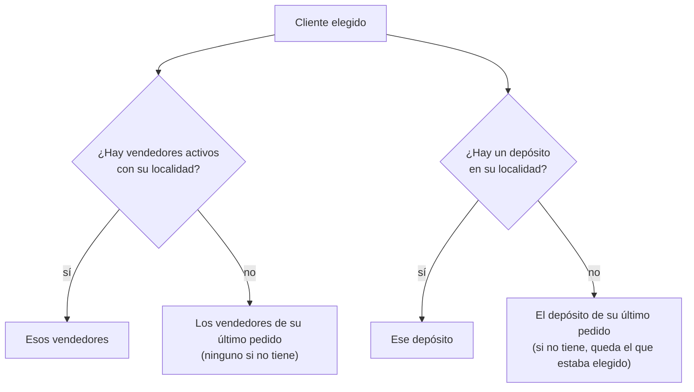

Las localidades se comparan sin mayúsculas ni tildes; la de un depósito puede traer la provincia después
de una coma ("Rosario, Santa Fe"). Ejemplos con Guada/Hernán en Rosario, Leo sin localidad y los depósitos
General (Bahía Blanca) y Rosario:

| Cliente | Localidad | Último pedido | Vendedores propuestos | Depósito propuesto |
|---|---|---|---|---|
| Dietética de ejemplo | Rosario | — | Guada/Hernán | Rosario |
| Almacén de Funes | Funes | General, con Leo | Leo | General |
| Cliente sin datos | — | — | ninguno | el elegido |

### Precio

Al crear el pedido, cada línea propone el precio vigente del producto en *Precios* (la fila con `desde` más
reciente que no sea posterior a la fecha del pedido). Se puede cambiar por un precio especial. La línea
guarda los dos (`precio_lista` y `precio`) y desde ese momento el precio **no cambia**: ni si se actualiza
la lista mientras se compra o se mueve la mercadería, ni al entregar. Cada venta copia el `precio` de la
línea del pedido que entrega, y en la entrega no se puede editar.

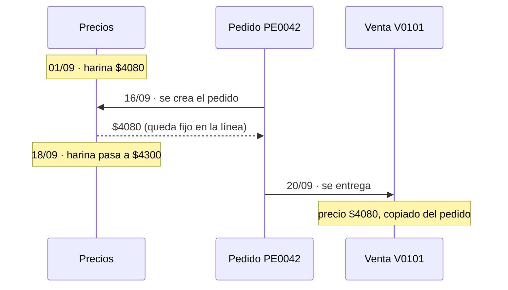

Si un producto no tiene precio en la lista, el precio que se carga en el pedido se agrega a *Precios*.

Para cada línea del pedido:

```
entregado(línea) = Σ cantidad de Ventas ítems con esa pedido_linea
pendiente(línea) = cantidad − entregado(línea)       (0 si el pedido está cancelado o cerrado)
```

### Estados del pedido

El avance de la entrega se calcula; en *Pedidos estados* solo se guarda lo que decide una persona.

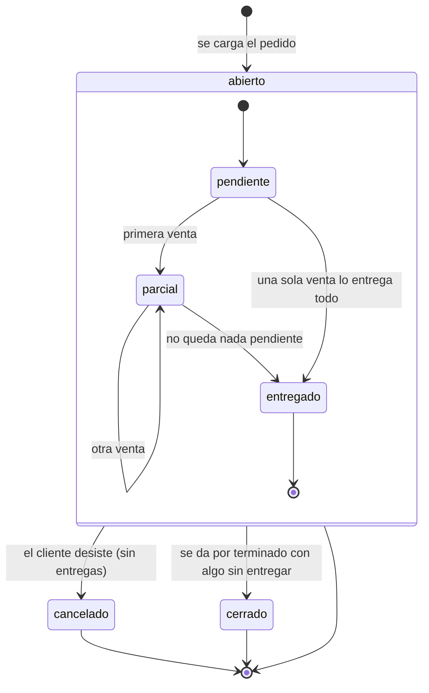

| Estado | Cómo se sabe | Reserva stock |
|---|---|---|
| pendiente | abierto y sin ventas | sí, todo |
| parcial | abierto, con ventas y algo pendiente | sí, lo pendiente |
| entregado | abierto y sin nada pendiente | no |
| cancelado | fila en *Pedidos estados* | no |
| cerrado | fila en *Pedidos estados* | no |

### Ventas directas

Una venta siempre pertenece a un pedido, así todos los análisis (fletes, ganancia por pedido) funcionan
igual. Cuando se vende en el momento, sin pedido previo, se marca "Se entrega ahora (venta directa)" en el
pedido: la app crea el pedido y la venta en la misma operación, con las comisiones de las reglas. La venta
directa no cobra envío: el cliente se lleva la mercadería en el momento.

## Ventas (entregas)

La venta es la entrega al cliente en la ciudad de destino. Es el momento en que:

- **sale el stock** del depósito de la venta;
- **se fija el costo** de la mercadería (costo promedio a esa fecha);
- **se genera la comisión**.

Un pedido puede entregarse en varias ventas (entregas parciales). Cada ítem de venta apunta a la línea del
pedido que entrega; el precio se copia de esa línea y no se puede cambiar en la venta.

Si al entregar no hay stock suficiente en el depósito, la app **avisa** pero deja registrar la venta. El
stock del depósito puede quedar negativo, y eso indica que falta registrar una compra, un flete o un ajuste.

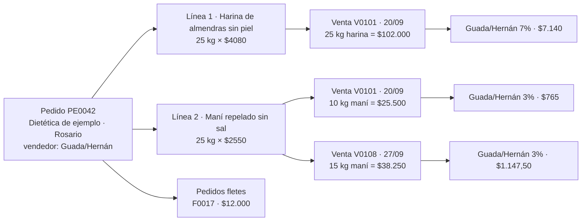

En el ejemplo, la venta V0101 tiene dos ítems (las dos primeras cajas) y la V0108 completa el maní.

## Envíos

Lo dijo el dueño: "si es por compras menores a $150.000 cobro $5.000 el envío; si es mayor, es sin cargo. El
envío que se cobra va para quien hace la entrega, sumando también la comisión".

- El costo y el mínimo se configuran en la pantalla **Precios** (hoja *Envíos*), con su fecha `desde`, como los
  precios de lista.
- Al registrar una entrega, la app propone el `costo` de la regla vigente si el **importe del pedido** (lo
  pedido, no solo lo que se entrega ahora) es menor que `minimo`. Se cobra **una vez por pedido**: si una
  entrega anterior del pedido ya tiene fila en *Ventas envíos* (aunque sea con costo 0), las siguientes
  proponen 0.
- El costo se puede cambiar en la entrega (por ejemplo, 0 para no cobrarlo). La fila guarda los dos valores.
  Si no se propuso ni se cobró nada, no se agrega fila.
- El envío es para quien hizo la entrega: la app propone el primer vendedor del pedido; si el pedido no tiene
  vendedores, el negocio. Se puede elegir otro vendedor del pedido o el negocio.

Efectos:

- **Importe a cobrar de la venta**: suma el envío (ver [Saldo a cobrar](#saldo-a-cobrar-de-una-venta)).
- **Cuenta del socio**: el envío de un vendedor se le acredita a su socio, como la comisión (ver
  [Cuenta de un socio](#cuenta-de-un-socio-con-el-dueño)).
- **Ganancia del pedido**: el envío de un vendedor entra (lo paga el cliente) y sale (es del vendedor): no la
  cambia. El que queda para el negocio la aumenta.
- **Ventas y Análisis** (por producto) no incluyen el envío: no es de ningún producto.

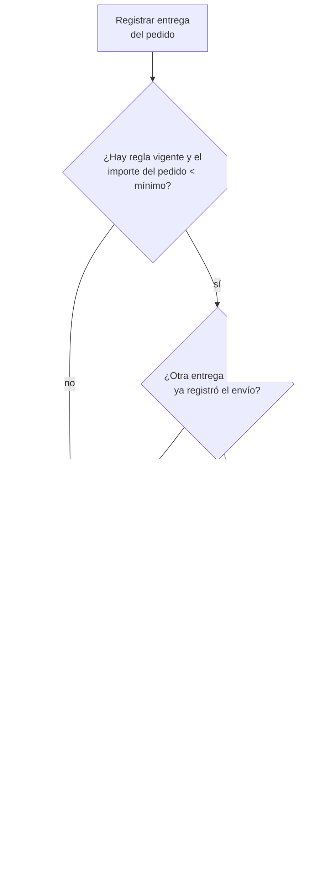

| Caso (regla: $5.000 por menos de $150.000) | Propuesto | Fila en *Ventas envíos* |
|---|---|---|
| Pedido de $8.000 de avena de Guada/Hernán, entregado entero | $5.000 | `V0101`, `VEN02`, 5000, 5000 |
| Pedido de $180.000, entregado entero | $0 | ninguna |
| Pedido de $100.000 de Leo, entregado en dos partes | 1.ª: $5.000 · 2.ª: $0 | solo en la 1.ª: `V0102`, `VEN01`, 5000, 5000 |
| Pedido de $8.000 en que no se cobra el envío (se pone 0) | $5.000 | `V0103`, `VEN02`, 5000, 0 |
| Pedido de $8.000 sin vendedores | $5.000, para el negocio | `V0104`, vacío, 5000, 5000 |

## Comisiones

El porcentaje de comisión depende del vendedor y, a veces, del producto. Por ejemplo:

| vendedor | producto | porcentaje |
|---|---|---|
| VEN01 Guada/Hernán | (general) | 3 |
| VEN01 Guada/Hernán | harinas de almendras sin piel y con piel, harina de coco | 7 |
| VEN01 Guada/Hernán | maní repelado tostado con sal y sin sal | 10 |
| VEN02 Leo | almendras non pareil, arándanos rojos, castañas W4, frasco de aceite de coco 360cc | 10 |

Leo no tiene regla general: en los demás productos no comisiona.

Los vendedores se asignan al **pedido** (*Pedidos vendedores*). La comisión se genera en cada **venta**,
para cada ítem entregado y cada vendedor del pedido:

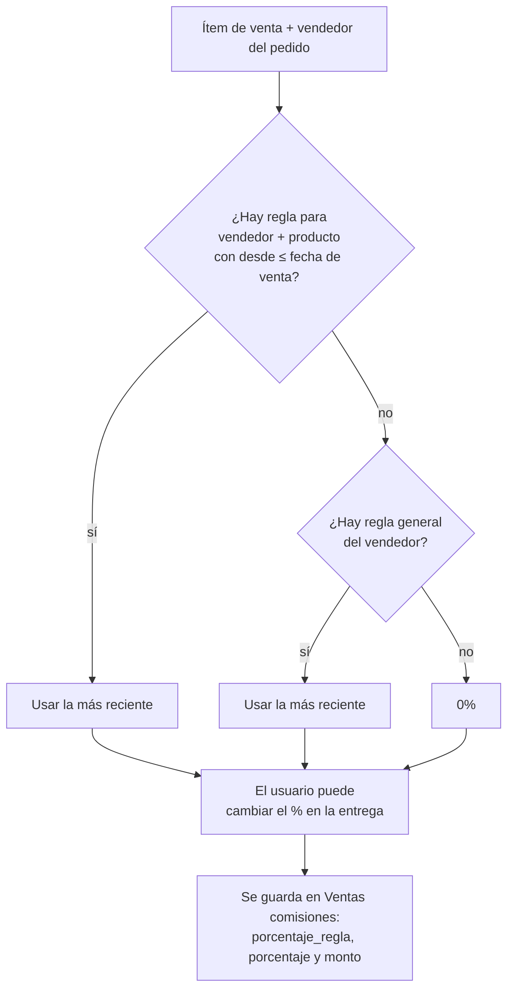

- La comisión se calcula sobre el **precio final** del ítem entregado: `monto = importe × porcentaje / 100`.
- Un pedido puede tener **varios vendedores**: cada uno tiene su fila por ítem y su propio porcentaje.
  Todos los vendedores de un pedido comisionan por todas sus líneas.
- Lo pedido y no entregado no genera comisión.
- Si cambia un porcentaje, se agrega una regla con un `desde` nuevo. Las ventas anteriores conservan el
  porcentaje con el que se guardaron.
- La regla que se aplica es la vigente a la fecha de la entrega.
- La liquidación de un vendedor en un período es la suma de `monto` de sus filas, filtrando por la fecha
  de la venta (la entrega).

## Fletes

Un flete es un viaje con un transporte y un costo. Según el origen y el destino, cubre tres casos:

| Caso | `origen_id` | `destino_id` | Fletes ítems | Pedidos fletes | ¿Mueve stock? |
|---|---|---|---|---|---|
| **Transferencia** (Bahía Blanca → Rosario) | depósito | depósito | sí | opcional | sí, según el estado |
| **Entrega a cliente** | depósito | vacío | no | sí | no: la venta descuenta el stock |
| **Compra con flete** (de un proveedor a un depósito) | vacío | depósito | no | opcional | no: la compra suma el stock |

Un mismo flete puede llevar mercadería para varios pedidos y, a la vez, stock general para el depósito de
destino. Solo los *Fletes ítems* mueven stock, así ninguna mercadería se cuenta dos veces.

### Estados

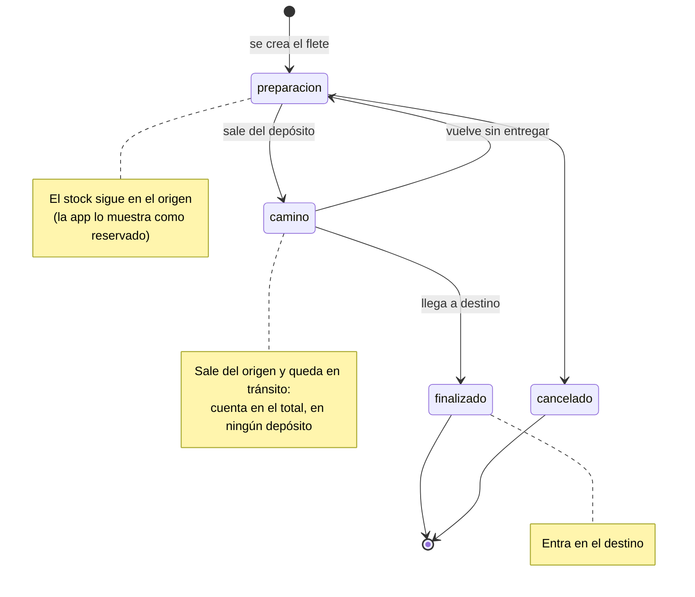

Si se rompe o se pierde mercadería en el viaje, el flete se marca como finalizado igual y la pérdida se
registra como un ajuste negativo en el depósito de destino (por ejemplo, motivo "Bolsa rota en flete
F0002"). El flete no guarda la cantidad recibida.

`cancelado` es para un flete que se arma y no sale. Mientras está en preparación, la mercadería no se
movió, así que cancelarlo no toca el stock.

### Ejemplo: transferencia de Bahía Blanca a Rosario para un pedido

| Hoja | Fila |
|---|---|
| Fletes | `F0020`, 19/06/2026, Interprovincial, origen `BB`, destino `ROS`, costo $159.720 |
| Fletes ítems | `F0020`, P014 harina de almendras sin piel, 500 |
| Pedidos fletes | `PE0050`, `F0020`, $159.720 |
| Fletes estados | `F0020`, 19/06 09:00, `preparacion` |
| Fletes estados | `F0020`, 19/06 18:00, `camino` |
| Fletes estados | `F0020`, 21/06 11:00, `finalizado` |

Stock de P014 en cada momento (empieza con 800 en Bahía Blanca y 100 en Rosario):

| Momento | Bahía Blanca | En tránsito | Rosario | Total |
|---|---|---|---|---|
| preparación | 800 (500 reservados) | 0 | 100 | 900 |
| en camino | 300 | 500 | 100 | 900 |
| finalizado | 300 | 0 | 600 | 900 |
| venta de 500 al cliente de PE0050 | 300 | 0 | 100 | 400 |

## Cálculo de stock

Para un producto *p* y un depósito *d*, contando cada flete según su estado actual:

```
stock(p, d) =   Σ compras(p, d)
              − Σ ventas_items(p, d)          (d = depósito de la venta)
              + Σ ajustes(p, d)
              − Σ fletes_items(p) con origen = d  y estado ∈ {camino, finalizado}
              + Σ fletes_items(p) con destino = d y estado = finalizado

en_transito(p, d)  = Σ fletes_items(p) con destino = d y estado = camino
reservado_flete(p, d) = Σ fletes_items(p) con origen = d y estado = preparacion
comprometido(p, d) = Σ pendiente de pedidos abiertos con deposito_id = d
disponible(p, d)   = stock(p, d) − reservado_flete(p, d) − comprometido(p, d)
faltante(p, d)     = max(0, comprometido(p, d) − stock(p, d) − en_transito(p, d))
total(p)           = Σ_d stock(p, d) + Σ_d en_transito(p, d)
```

`faltante` responde "qué hay que comprar o mandar a este depósito para cubrir los pedidos abiertos".
Un pedido abierto está **con faltante de stock** si alguna de sus líneas pendientes es de un producto con
`faltante(p, d) > 0` en su depósito de entrega. Por ejemplo, con 0 kg de almendras en Rosario y 6 kg en camino,
un pedido nuevo de 12 kg en Rosario queda con faltante (12 − 0 − 6 = 6) hasta que se mande un flete con los 6 kg
que faltan. La pantalla Inicio y los indicadores de Pedidos usan esta marca.

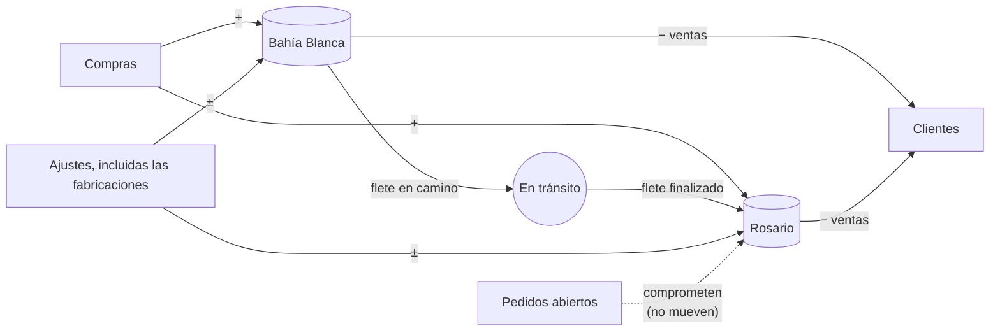

El **costo promedio** se sigue calculando con todas las compras con precio, sumando los dos depósitos. Un producto
que solo se fabrica no tiene costo promedio (ver [recetas.md](recetas.md#costo)). Una
transferencia no cambia el costo de la mercadería: su costo es un gasto de logística (ver abajo).

### Flete para cubrir faltantes

En Inicio, cada depósito con pedidos en falta tiene un botón **Crear flete a <depósito>**. Al tocarlo se eligen
cuáles de esos pedidos cubre el flete (todos, al principio) y `fleteParaFaltantes` propone el flete, que se carga
en el formulario de Fletes para completar el transporte y registrarlo (nada se guarda hasta entonces):

- **Destino**: el depósito de los pedidos.
- **Productos**: cada producto con faltante en alguna línea pendiente de los pedidos elegidos, en el orden de los
  pedidos (más viejo primero), con `min(Σ pendiente en los pedidos elegidos, faltante(p, destino))`: lo que hay en
  el depósito o viene en camino cubre primero.
- **Origen**: el otro depósito que más cubre de esos productos con su stock libre,
  `max(0, disponible(p, d))`; con empate, el primero de la hoja.
- **Pedidos que lleva**: los elegidos, con el costo repartido como en cualquier flete.

Por ejemplo, con 25 kg de avena en Rosario, el pedido de Ana del 10/10 (10 kg de avena) y uno nuevo (12 kg de
almendras y 30 de avena), faltan 15 kg de avena y 6 de almendras (hay 6 en camino). Con los dos pedidos, el flete
lleva 15 kg de avena (de 40 pendientes, solo faltan 15) y 6 de almendras; con solo el del 10/10, 10 kg de avena.

## Cobros y cuentas entre socios

La mercadería es del **dueño** (Sampatti, la empresa de Leo). Los otros socios (Guada/Hernán) venden,
cobran una comisión y a veces reciben la plata de la venta. La app registra quién tiene la plata de cada
venta para saber cómo repartirla.

### Saldo a cobrar de una venta

```
importe(venta) = Σ importe de sus Ventas ítems + costo de su fila en Ventas envíos
cobrado(venta) = Σ importe de sus Cobros
a cobrar(venta) = importe(venta) − cobrado(venta)
```

Lo que falta cobrar es deuda del cliente. La app no deja cobrar más que lo que falta.

Un cobro se carga desde la pantalla **Caja** (eligiendo la venta) o al registrar la entrega en **Pedidos**
("Cobrado en la entrega"): en ese caso la venta y el cobro van en el mismo `batchUpdate`. La app propone
como socio que recibió la plata al del vendedor del pedido y, si no tiene, al dueño.

### Cuenta de un socio con el dueño

Para cada socio que no es el dueño:

```
saldo(socio) =   Σ cobros que recibió el socio
               − Σ comisiones de sus vendedores (de todas las ventas, las cobre quien las cobre)
               − Σ envíos de sus vendedores (ídem)
               − Σ rendiciones que el socio entregó
               + Σ rendiciones que el socio recibió
```

- **Positivo**: el socio tiene plata del dueño; le debe ese saldo.
- **Negativo**: el dueño le debe al socio (por ejemplo, comisiones de ventas que cobró el dueño).

El dueño no tiene cuenta: es la contraparte de las demás. Las comisiones y envíos de un vendedor sin socio, o
del propio dueño (Leo), no entran en ninguna cuenta.

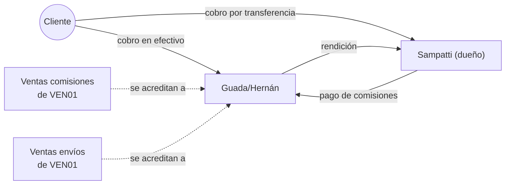

### Ejemplo

Guada/Hernán (vendedor `VEN01`, socio `SOC02`) tiene 3% de comisión en avena y 7% en almendras.

| Paso | Filas | Saldo de Guada/Hernán |
|---|---|---|
| 1. Entrega `V0101`: 10 kg de avena × $800 = $8.000 a una dietética. Cobra todo en efectivo. | Ventas comisiones: `V0101`, `VEN01`, 3%, $240 · Cobros: 16/10, `V0101`, $8.000, `efectivo`, `SOC02` | 8.000 − 240 = **$7.760** (le debe a Sampatti) |
| 2. Le rinde $7.000 en efectivo a Sampatti. | Rendiciones: 16/10, `SOC02`, `SOC01`, $7.000, `efectivo` | 7.760 − 7.000 = **$760** |
| 3. Entrega `V0102`: 5 kg de almendras × $3.000 = $15.000. La cobra Sampatti por transferencia. | Ventas comisiones: `V0102`, `VEN01`, 7%, $1.050 · Cobros: 16/10, `V0102`, $15.000, `transferencia`, `SOC01` | 760 − 1.050 = **−$290** (Sampatti le debe) |
| 4. Sampatti le transfiere $290. | Rendiciones: 16/10, `SOC01`, `SOC02`, $290, `transferencia` | −290 + 290 = **$0** (al día) |
| 5. Entrega `V0103`: otro pedido de $8.000 de avena, por menos del mínimo: $5.000 de envío para Guada/Hernán. Cobra $13.000 en efectivo. | Ventas comisiones: `V0103`, `VEN01`, 3%, $240 · Ventas envíos: `V0103`, `VEN01`, 5000, 5000 · Cobros: 16/10, `V0103`, $13.000, `efectivo`, `SOC02` | 13.000 − 240 − 5.000 = **$7.760** |

Es lo que dijo el dueño: "si Guada/Hernán vendieron y se llevan comisión, pero además cobran en efectivo,
le deben a Sampatti efectivo − comisión".

## Análisis

La unidad de análisis de la ganancia es el **pedido**, porque es donde se juntan las entregas, las
comisiones y los fletes:

- **Importe del pedido** = Σ `importe` de los ítems de sus ventas.
- **Comisiones** = Σ `monto` de las comisiones de sus ventas.
- **Costo de mercadería** = Σ `cantidad × costo` de los ítems de sus ventas.
- **Costo de fletes** = Σ `costo_asignado` de sus filas en *Pedidos fletes*.
- **Envíos del negocio** = Σ `costo` de sus filas en *Ventas envíos* sin `vendedor_id`.
- **Ganancia** = importe + envíos del negocio − comisiones − costo de mercadería − costo de fletes.

Reparto del costo de un flete entre varios pedidos: la app propone repartir `costo` en proporción al
importe pedido, y el usuario puede cambiarlo. Lo que no se asigna a ningún pedido (por ejemplo, una
transferencia para reponer stock) cuenta como gasto de logística del mes. Control: para cada flete,
Σ `costo_asignado` ≤ `costo`.

| Indicador | Cálculo |
|---|---|
| Ganancia por pedido | ver arriba |
| Ventas del mes | Σ importe de ventas con fecha en el mes (fecha de entrega) |
| Pedidos pendientes | pedidos abiertos con algo pendiente, y su importe pendiente |
| Comisión por vendedor | Σ `monto` por vendedor y mes de la venta |
| Costo de flete sobre ventas | Σ costo de fletes del mes / Σ importe de ventas del mes |
| Gasto de logística del mes | Σ costo de fletes − Σ costo asignado a pedidos |
| Mercadería en tránsito | `en_transito(p) × costo promedio` |
| Faltante por depósito | `faltante(p, d)` para los pedidos abiertos |
| Tiempo de entrega | fecha de la última venta − fecha del pedido |

La pantalla Análisis (ganancia por producto, más vendidos, clientes activos e inactivos) está descripta en
[analisis.md](analisis.md).

## Preguntas abiertas

- **Depósito por pedido o por línea.** Esta spec usa uno por pedido. Si un pedido puede entregarse en parte
  desde Bahía Blanca y en parte desde Rosario, el depósito pasa a la línea.
- **Comisión o cobro de los fletes.** No se modelan; falta saber si el flete tiene una comisión o un cobro
  al cliente. El envío al cliente final sí se cobra (ver [Envíos](#envíos)).
- **Envío con varios vendedores.** Si el pedido tiene varios vendedores, el envío es de uno solo (el que se
  elige en la entrega). Falta saber si en algún caso se reparte.
- **Envío por entrega o por pedido.** El mínimo se compara con el importe del pedido y el envío se cobra una
  vez. Si cada entrega parcial es un viaje que se cobra aparte, hay que comparar con el importe de la entrega.
- **IDs con varios usuarios a la vez.** La app calcula el siguiente ID con lo último que leyó. Si dos
  personas cargan un pedido al mismo tiempo, pueden quedar dos con el mismo ID.
- **Costo de las transferencias.** Esta spec lo trata como gasto de logística (o lo asigna a pedidos). La
  alternativa es sumarlo al costo de la mercadería en el depósito de destino, pero eso exige un costo
  promedio por depósito.
- **Comisiones de ventas sin cobrar.** La cuenta de un socio descuenta sus comisiones desde la entrega,
  aunque el cliente todavía no haya pagado. La alternativa es acreditarlas recién cuando se cobra la venta
  (o en proporción a lo cobrado).
- **Ventas históricas sin cobros.** Las ventas cargadas del Excel histórico no tienen cobros y figuran como "a
  cobrar". Falta decidir si se cargan como cobradas (¿por quién?) o si se marca una fecha de corte.
- **Pagos a proveedores.** El pedido original hablaba de qué se le paga a cada proveedor en efectivo o por
  transferencia. Esta parte cubre las ventas; las compras no registran todavía cómo ni quién las pagó.
- **Otros medios.** Solo hay `efectivo` y `transferencia`. Si aparecen otros (cheque, Mercado Pago), se
  agregan a la lista.
- **Rendiciones entre socios que no son el dueño.** La hoja las admite y el cálculo las cuenta, pero la
  pantalla solo carga rendiciones entre un socio y el dueño.
- **Fabricar sin stock.** La app avisa si un insumo no alcanza en el depósito pero deja fabricar igual (el stock
  queda negativo, como con una venta). Falta decidir si se bloquea.
- **Costo de lo fabricado.** Las fabricaciones no guardan costo: un producto que solo se fabrica no tiene costo
  promedio y sus ventas quedan sin costo (la ganancia no lo descuenta). Si hace falta, se puede guardar el costo
  de los insumos en el momento de fabricar.
- **Volver de "en camino" a "preparación".** Está en el diagrama para el caso de un flete que vuelve sin
  entregar; si no pasa nunca, se saca.
