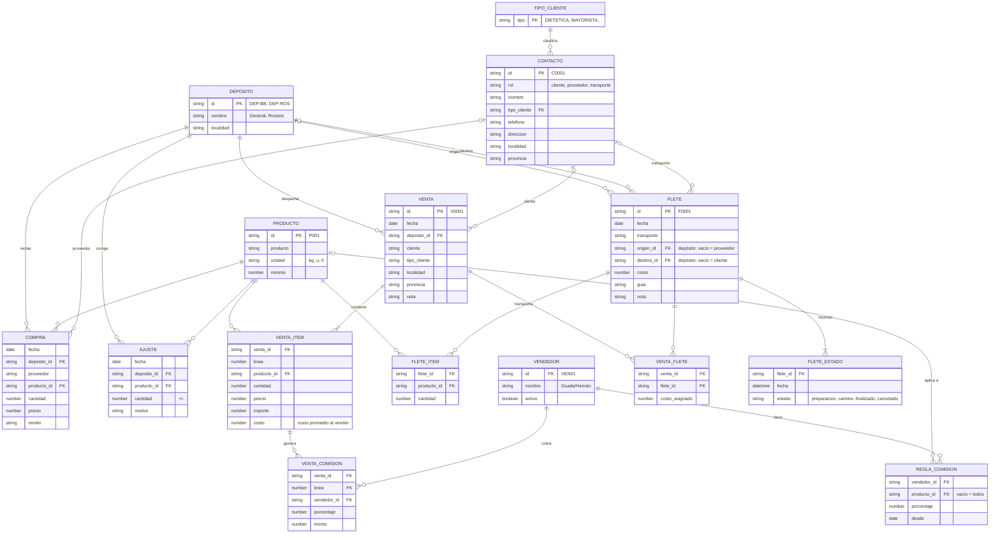
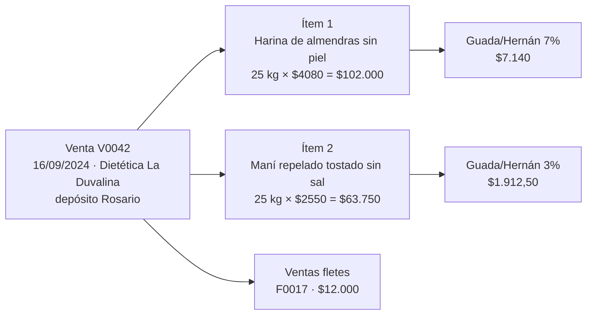
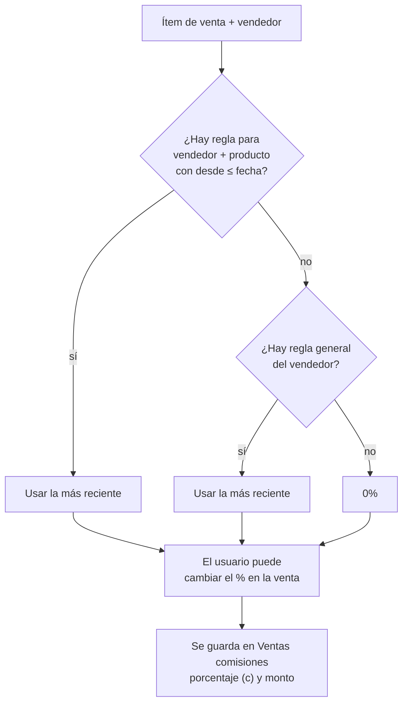
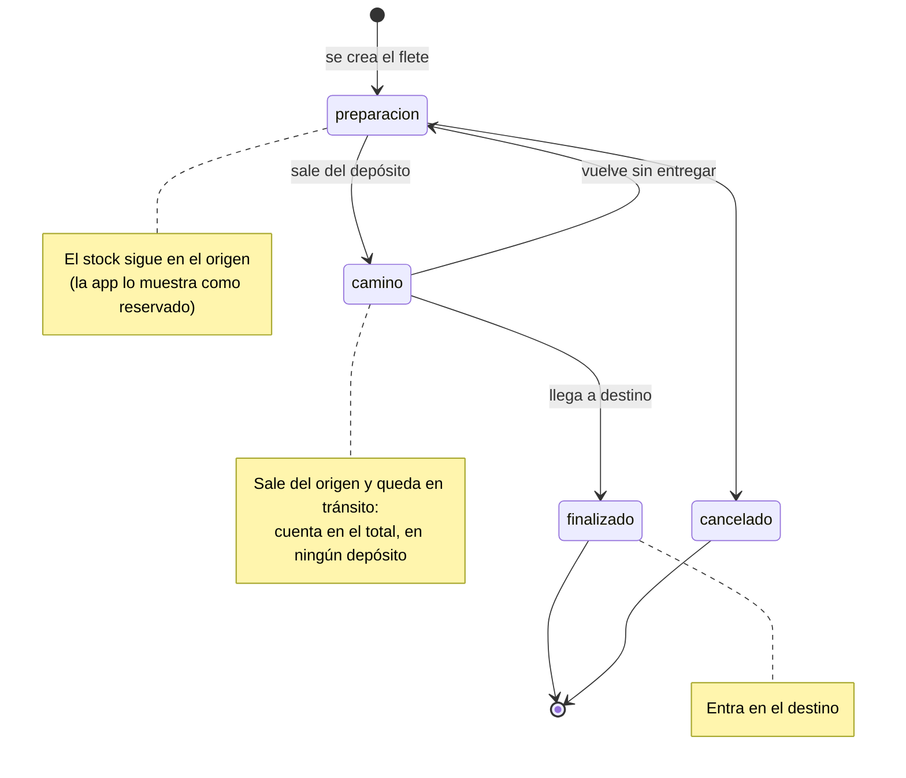
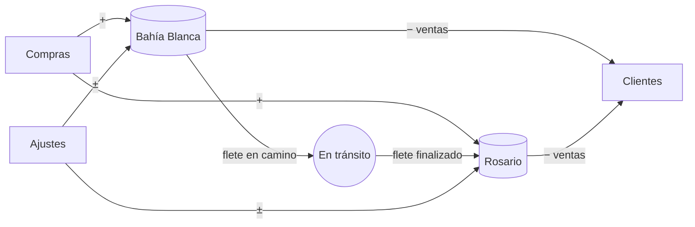

# Modelo de datos

Especificación del modelo de datos de ERPeq sobre Google Sheets: una hoja por tabla, primera fila con
encabezados, una fila por registro.

Incluye cuatro cambios respecto del modelo actual ([src/modelo.ts](../src/modelo.ts)):

1. Una venta tiene varios productos (cabecera + ítems).
2. Las comisiones dependen del vendedor y del producto, y una venta puede comisionar a más de un vendedor.
3. Una venta puede ir en uno o más fletes, y un flete puede llevar varias ventas.
4. Los fletes entre depósitos mueven stock y tienen estados: en preparación, en camino y finalizado.

## Principios

- **Solo se agregan filas.** Nada se edita ni se borra: las correcciones son filas nuevas (un ajuste, un
  nuevo estado de flete). Así la planilla funciona como un historial y el stock se puede recalcular siempre.
- **Lo derivado se calcula.** El stock, el estado actual de un flete y el costo promedio salen de los
  movimientos. Lo único que se guarda calculado es lo que tiene que quedar fijo al momento de la operación
  (precio, costo, porcentaje de comisión): si después cambia el costo promedio o una regla de comisión, las
  ventas pasadas no cambian.
- **Referencias por ID.** Cada tabla tiene un ID con prefijo (`P001`, `V0001`, `F0001`…). Las filas que
  apuntan a un producto guardan también el nombre como copia, para que la hoja se pueda leer a mano.
- **Una operación, un `batchUpdate`.** Una venta escribe cabecera, ítems, comisiones y vínculos con fletes
  en varias hojas. Se manda todo en un solo `spreadsheets.batchUpdate` con `appendCells`, que la API aplica
  completo o no aplica nada, así no quedan ventas a medio escribir.

## Diagrama entidad-relación



## Tablas (hojas)

Las columnas se listan en el orden de la hoja. **(c)** indica una copia guardada al momento de la operación.

### Maestros

| Hoja | Columnas | Notas |
|---|---|---|
| **Depósitos** | `id`, `nombre`, `localidad` | Reemplaza la lista fija `DEPOSITOS` de `config.ts`. Hoy: General (Bahía Blanca) y Rosario. |
| **Productos** | `id`, `producto`, `unidad`, `minimo` | Igual que ahora. Las columnas de stock con fórmulas pasan a ser opcionales. |
| **Contactos** | `id`, `rol`, `nombre`, `tipo_cliente`, `telefono`, `direccion`, `email`, `localidad`, `provincia`, `observaciones` | Clientes, proveedores y transportes (la hoja *ALTA CLIEN-PROV* del Excel). |
| **Tipos de cliente** | `tipo` | Pierde la columna de comisión, que pasa a *Reglas de comisión*. |
| **Vendedores** | `id`, `nombre`, `activo` | Quien vende y cobra comisión. "Guada/Hernán" es **un** vendedor; "Leo" es otro. |
| **Reglas de comisión** | `vendedor_id`, `producto_id`, `porcentaje`, `desde` | `producto_id` vacío = regla general del vendedor. |

### Movimientos

| Hoja | Columnas | Notas |
|---|---|---|
| **Compras** | `fecha`, `deposito_id`, `proveedor`, `contacto_id`, `producto_id`, `producto` (c), `cantidad`, `precio`, `importe`, `remito`, `nota` | Igual que ahora, con el depósito y el proveedor como referencias. |
| **Ventas** | `id`, `fecha`, `deposito_id`, `contacto_id`, `cliente` (c), `tipo_cliente` (c), `localidad` (c), `provincia` (c), `nota` | Una fila por venta (cabecera). Los totales no se guardan: se suman de los ítems. |
| **Ventas ítems** | `venta_id`, `linea`, `producto_id`, `producto` (c), `cantidad`, `precio`, `importe`, `costo` (c) | Una fila por producto vendido. `costo` es el costo promedio unitario al vender. |
| **Ventas comisiones** | `venta_id`, `linea`, `vendedor_id`, `vendedor` (c), `porcentaje` (c), `monto` | Una fila por ítem y vendedor. `monto = importe × porcentaje / 100`. |
| **Fletes** | `id`, `fecha`, `transporte`, `contacto_id`, `origen_id`, `destino_id`, `costo`, `guia`, `nota` | `origen_id` / `destino_id` son depósitos; vacío = afuera (proveedor o cliente). |
| **Fletes ítems** | `flete_id`, `producto_id`, `producto` (c), `cantidad` | Solo para mercadería que va **entre depósitos**. |
| **Fletes estados** | `flete_id`, `fecha`, `estado` | Cada cambio de estado es una fila nueva. El estado actual es el de la fila más reciente. |
| **Ventas fletes** | `venta_id`, `flete_id`, `costo_asignado` | Une ventas y fletes (N a N). `costo_asignado` es la parte del flete que se carga a esa venta. |
| **Ajustes** | `fecha`, `deposito_id`, `producto_id`, `producto` (c), `cantidad`, `motivo` | Igual que ahora (roturas, conteos). |

## Ventas con varios productos

La venta es la cabecera (quién, cuándo, desde qué depósito) y cada producto es un ítem. Los totales se
calculan:

- **Importe de la venta** = Σ `importe` de sus ítems.
- **Comisiones de la venta** = Σ `monto` de sus comisiones.
- **Costo de mercadería** = Σ `cantidad × costo` de sus ítems.
- **Ganancia** = importe − comisiones − costo de mercadería − Σ `costo_asignado` de sus fletes.



## Comisiones

El porcentaje de comisión depende del vendedor y, a veces, del producto. En el Excel, Guada/Hernán cobra 3%
en general y 7% en harinas de almendras y de coco, y en algunas ventas aparece un 10%. Esto se modela con
reglas:

| vendedor_id | producto_id | porcentaje | desde |
|---|---|---|---|
| VEN01 (Guada/Hernán) | | 3 | 2024-01-01 |
| VEN01 (Guada/Hernán) | P014 (harina de almendras sin piel) | 7 | 2024-01-01 |
| VEN01 (Guada/Hernán) | P015 (harina de almendras con piel) | 7 | 2024-01-01 |
| VEN02 (Leo) | | 10 | 2024-01-01 |

Al cargar una venta, la app elige el porcentaje para cada ítem y cada vendedor:



- La comisión se calcula sobre el **precio final** del ítem: `monto = importe × porcentaje / 100`.
- Una venta puede comisionar a **varios vendedores**: cada uno tiene su fila por ítem y su propio porcentaje.
  Si un ítem no comisiona a nadie, no tiene filas.
- Si cambia un porcentaje, se agrega una regla con un `desde` nuevo. Las ventas anteriores conservan el
  porcentaje con el que se guardaron.
- La liquidación de un vendedor en un período es la suma de `monto` de sus filas, filtrando por la fecha
  de la venta.

## Fletes

Un flete es un viaje con un transporte y un costo. Según el origen y el destino, cubre tres casos:

| Caso | `origen_id` | `destino_id` | Fletes ítems | Ventas fletes | ¿Mueve stock? |
|---|---|---|---|---|---|
| **Transferencia** (Bahía Blanca → Rosario) | depósito | depósito | sí | opcional | sí, según el estado |
| **Entrega a cliente** | depósito | vacío | no | sí | no: la venta ya descuenta el stock |
| **Compra con flete** (de un proveedor a un depósito) | vacío | depósito | no | no | no: la compra ya suma el stock |

Un mismo flete puede ser transferencia y entrega a la vez: lleva mercadería a Rosario (Fletes ítems) y,
en el mismo viaje, pedidos de clientes (Ventas fletes). Solo los ítems del flete mueven stock, así ninguna
mercadería se cuenta dos veces.

### Estados



`cancelado` no está en el pedido original: es para un flete que se arma y no sale. Mientras está en
preparación, la mercadería no se movió, así que cancelarlo no toca el stock.

### Ejemplo: transferencia de Bahía Blanca a Rosario

| Hoja | Fila |
|---|---|
| Fletes | `F0020`, 19/06/2026, Interprovincial, origen `DEP-BB`, destino `DEP-ROS`, costo $159.720 |
| Fletes ítems | `F0020`, P014 harina de almendras sin piel, 500 |
| Fletes estados | `F0020`, 19/06 09:00, `preparacion` |
| Fletes estados | `F0020`, 19/06 18:00, `camino` |
| Fletes estados | `F0020`, 21/06 11:00, `finalizado` |

Stock de P014 en cada momento (empieza con 800 en Bahía Blanca y 100 en Rosario):

| Momento | Bahía Blanca | En tránsito | Rosario | Total |
|---|---|---|---|---|
| preparación | 800 (500 reservados) | 0 | 100 | 900 |
| en camino | 300 | 500 | 100 | 900 |
| finalizado | 300 | 0 | 600 | 900 |

## Cálculo de stock

Para un producto *p* y un depósito *d*, contando cada flete según su estado actual:

```
stock(p, d) =   Σ compras(p, d)
              − Σ ventas_items(p, d)          (d = depósito de la venta)
              + Σ ajustes(p, d)
              − Σ fletes_items(p) con origen = d  y estado ∈ {camino, finalizado}
              + Σ fletes_items(p) con destino = d y estado = finalizado

en_transito(p) = Σ fletes_items(p) con estado = camino
reservado(p, d) = Σ fletes_items(p) con origen = d y estado = preparacion
total(p)        = Σ_d stock(p, d) + en_transito(p)
```



El **costo promedio** se sigue calculando con todas las compras con precio, sumando los dos depósitos. Una
transferencia no cambia el costo de la mercadería: su costo es un gasto de logística (ver abajo).

## Fletes en el análisis

- **Costo de flete de una venta** = Σ `costo_asignado` de sus filas en *Ventas fletes*. Entra en la ganancia.
- Si una venta usa **varios fletes** (por ejemplo, una transferencia a Rosario y después la entrega al
  cliente), tiene una fila por flete.
- **Reparto del costo de un flete entre varias ventas.** La app propone repartir `costo` en proporción al
  importe de cada venta, y el usuario puede cambiarlo. Lo que no se asigna a ninguna venta (por ejemplo,
  una transferencia de stock sin ventas asociadas) cuenta como gasto de logística del mes.
- **Control:** para cada flete, Σ `costo_asignado` ≤ `costo`.

Indicadores que habilita:

| Indicador | Cálculo |
|---|---|
| Ganancia neta por venta | importe − comisiones − costo de mercadería − costo de flete asignado |
| Costo de flete sobre ventas | Σ costo de fletes del mes / Σ importe de ventas del mes |
| Gasto de logística del mes | Σ costo de fletes − Σ costo asignado a ventas |
| Mercadería en tránsito | `en_transito(p) × costo promedio` |
| Comisión por vendedor | Σ `monto` por vendedor y mes |

## Migración desde el modelo actual

1. **Depósitos, Vendedores y Reglas de comisión:** se cargan a mano (son pocas filas). Los vendedores
   salen de la columna CARGA del Excel (GUADA/HERNAN, LEO).
2. **Ventas:** cada fila actual pasa a ser un ítem. Los ítems se agrupan en ventas por
   (`fecha`, `cliente`, `deposito`). La columna `carga` pasa a una fila en *Ventas comisiones* con el
   porcentaje que tenía (`comision / importe`).
3. **Fletes:** las filas actuales pasan con `origen_id` y `destino_id` vacíos y estado `finalizado`, sin
   ítems ni ventas asociadas. No cambian el stock. Las que indican destino en el texto ("YERBA A BAHIA",
   "H.A SP A BAHIA") se pueden completar a mano.
4. **Tipos de cliente:** la columna de comisión se descarta, porque la reemplazan las reglas.

## Preguntas abiertas

- **Depósito por venta o por ítem.** Esta spec usa uno por venta. Si una venta puede salir en parte de
  Bahía Blanca y en parte de Rosario, el depósito se pasa al ítem.
- **Hoja FLETES del Excel.** Tiene columnas *Abonado*, *Comisión* y *Total a recibir IKAL IBI* vacías, bajo
  el título "CAJA ROSARIO". Falta saber si el flete tiene una comisión o un cobro al cliente que haya que
  modelar.
- **Costo de las transferencias.** Esta spec lo trata como gasto de logística. La alternativa es sumarlo al
  costo de la mercadería en el depósito de destino, pero eso exige un costo promedio por depósito.
- **Volver de "en camino" a "preparación".** Está en el diagrama para el caso de un flete que vuelve sin
  entregar; si no pasa nunca, se saca.
