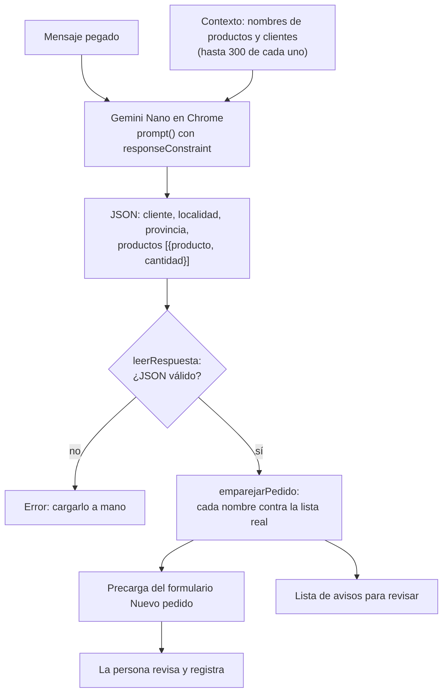

# Pedido desde un mensaje pegado (experimental)

En la pantalla **Pedidos**, el cuadro **Pegar pedido** convierte un mensaje de un cliente (por ejemplo, de
WhatsApp) en los datos del formulario *Nuevo pedido*: cliente, localidad, provincia, productos y cantidades.
Usa la IA integrada de Chrome (Prompt API con Gemini Nano), que corre en la computadora.

La IA **solo precarga** el formulario. Nunca guarda: la persona revisa, corrige y toca *Registrar pedido*.

## Cuándo aparece

El cuadro aparece solo si el navegador tiene `LanguageModel` y `LanguageModel.availability()` con entrada y
salida en español devuelve algo distinto de `unavailable`. En cualquier otro navegador (Firefox, Safari,
Chrome en el celular, Chrome en una compu sin el hardware necesario) no se muestra nada y el formulario
funciona igual que siempre.

| `availability()` | Qué muestra |
|---|---|
| `unavailable` o no existe la API | Nada. |
| `downloadable` / `downloading` | El cuadro, con el aviso de que la primera vez se descarga el modelo. Al tocar el botón empieza la descarga y se ve el progreso. |
| `available` | El cuadro. |

## Requisitos (según la documentación de Chrome)

Fuente: [Prompt API](https://developer.chrome.com/docs/ai/prompt-api) y
[Get started](https://developer.chrome.com/docs/ai/get-started) de developer.chrome.com.

- **Chrome de escritorio**: Windows 10/11, macOS 13 o más nuevo, Linux o ChromeOS (Chromebook Plus). No
  funciona en Chrome para Android ni iOS.
- **Versión**: la Prompt API para páginas web figura desde Chrome 148 (antes, solo extensiones u *origin
  trial*). No hace falta activar ningún flag ni registrar un *origin trial* en esas versiones.
- **Hardware**: GPU con más de 4 GB de VRAM, o 16 GB de RAM y 4 núcleos.
- **Disco**: 22 GB libres en el disco del perfil de Chrome. Si después quedan menos de 10 GB, Chrome borra el
  modelo y lo vuelve a bajar cuando haya lugar.
- **Red**: la descarga del modelo (varios GB) necesita una conexión sin límite de datos. Después funciona sin
  conexión.
- **Idioma**: entrada y salida en inglés, español, japonés, alemán y francés. La app pide español (`es`).
- La primera descarga necesita que la persona haya interactuado con la página; por eso empieza al tocar
  *Completar el pedido*.

Para ver el estado del modelo en una compu: `chrome://on-device-internals` (pestaña *Model Status*).

## Cómo funciona

1. Se crea una sesión con un mensaje de sistema que explica el formato y lista los productos y clientes
   existentes, para que el modelo use esos nombres.
2. `prompt()` recibe el mensaje y un JSON Schema (`responseConstraint`) que obliga a responder con
   `cliente`, `localidad`, `provincia` y `productos` (`producto` y `cantidad`).
3. `leerRespuesta` (en `src/pedido-texto.ts`) valida el JSON: descarta productos sin nombre y deja la
   cantidad vacía si no es un número mayor a 0.
4. `emparejar` compara cada nombre con la lista real, porque el modelo puede equivocarse o inventar.
5. Se cargan los datos en el formulario. El cliente pasa por la misma lógica que al escribirlo a mano
   (completa tipo, localidad y vendedores de su contacto o su último pedido) y después se pisan la localidad
   y la provincia si el mensaje las dice. Cada producto que coincide trae su precio de lista.

## Emparejamiento de nombres

`emparejar(texto, lista)` normaliza los dos nombres (minúsculas, sin acentos ni signos, sin palabras como
"de", "la", "kg", y en singular) y calcula un parecido entre 0 y 1 que combina las palabras en común con el
parecido letra a letra (tolera errores de tipeo).

| Resultado | Cuándo | Qué se carga | Aviso |
|---|---|---|---|
| `exacta` | Mismo nombre normalizado. | El nombre de la lista. | Ninguno. |
| `aproximada` | Parecido ≥ 0,6 con un solo nombre. | El nombre de la lista. | «avenna» se cargó como «Avena». |
| `dudosa` | Varios nombres contienen el texto entero, o empatan (diferencia < 0,05). | El texto tal cual. | «maní» puede ser Maní con cáscara o Maní pelado. |
| `ninguna` | Nada llega a 0,6. | El texto tal cual. | Cliente nuevo / localidad nueva / producto que no existe. |

Un producto que no coincide queda escrito en la línea y el formulario lo marca con *No existe ese producto*,
así que no se puede registrar hasta corregirlo. Un cliente que no coincide se registra como cliente nuevo,
igual que si se escribiera a mano.

### Ejemplo

Productos: Almendras, Harina de almendras, Maní pelado, Maní con cáscara, Avena. Clientes: Dietética La
Esquina, Ana.

> Hola! para la dietetica la esquina de Rosario mandame 25 kg de harina de almendras, 10 de maní y 5 de avenna

| Campo | La IA devuelve | Se carga | Aviso |
|---|---|---|---|
| Cliente | dietetica la esquina | Dietética La Esquina | — |
| Localidad | Rosario | Rosario | — |
| Producto 1 | harina de almendras, 25 | Harina de almendras, 25 | — |
| Producto 2 | maní, 10 | maní, 10 | Puede ser Maní con cáscara o Maní pelado. |
| Producto 3 | avenna, 5 | Avena, 5 | Se cargó como «Avena». |

## Privacidad

El modelo corre dentro de Chrome, en la computadora. Según la documentación de Chrome, no se manda nada a
Google ni a terceros al usarlo. La app no agrega ninguna conexión: la Content-Security-Policy de
`vite.config.ts` no cambia, porque la Prompt API es una función del navegador y no una llamada de red de la
página. El mensaje pegado no se guarda en ningún lado.

## Limitaciones

- Solo Chrome de escritorio con el hardware de arriba. En el celular no aparece.
- Gemini Nano es un modelo chico: puede confundir cantidades ("medio kilo", "una bolsa") o unidades. Por eso
  todo pasa por el formulario y se revisa.
- La lista de productos y clientes se recorta a 300 nombres de cada una para no llenar la ventana de
  contexto. Con más, los que quedan afuera se emparejan igual después, pero el modelo no los ve.
- No interpreta precios, fechas ni depósito: se completan como en un pedido normal.

## Preguntas abiertas

- **¿Sirve con mensajes reales?** No se probó con el modelo real ni con mensajes de clientes. Hace falta
  probarlo en una compu que cumpla los requisitos y ajustar las instrucciones o el umbral (0,6) según lo que
  salga.
- **Unidades.** Si un cliente pide "2 bolsas" de un producto que se vende por kg, la cantidad queda en 2. Falta
  decidir si se modelan presentaciones (bolsa de 25 kg, etc.).
- **Alias de clientes.** Si los clientes escriben con otro nombre (el del dueño en vez del negocio), haría
  falta una columna de alias en *Contactos*.
