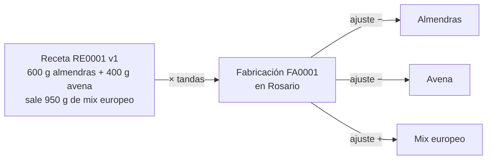

# Recetas y fabricación

Una **receta** dice qué insumos lleva una tanda de un producto (mix europeo, mix premium, yerba magia…) y cuánto
sale. **Fabricar** descuenta los insumos del stock de un depósito y suma el producto en el mismo depósito.

Las hojas están en [modelo-de-datos.md](modelo-de-datos.md#recetas): *Recetas* y *Recetas ítems*. Son
opcionales: sin ellas, la pantalla Recetas avisa cuáles crear y no deja guardar. Las fabricaciones no tienen hoja
propia: son filas de *Ajustes*.



## Recetas

- Cada receta tiene un ID (`RE0001`) y un **producto que sale**, que tiene que estar en *Productos* y tener
  precio de lista vigente (pantalla Precios). La receta no crea productos ni precios: el mix se da de alta antes,
  con su precio.
- Un producto tiene una sola receta activa: para cambiarla se edita la que existe.
- Los insumos y lo que sale se guardan **en la unidad de cada producto** (kg o unid.). La pantalla deja cargar
  las cantidades en gramos; las de productos en kg se guardan divididas por 1.000.
- **Lo que sale** propone la suma de los insumos que se miden en la misma unidad que el producto: sin merma sale
  lo que entra. Si se carga menos, la diferencia es la **merma** prevista: `merma = 1 − sale / entra`.
- **Versiones**: guardar una receta que ya existe agrega una versión nueva (`version` + 1) con su fecha `desde`.
  Dar de baja o volver a activar también agrega una versión, con los mismos insumos y `activa` en `no` o `sí`. La
  versión vigente a una fecha es la de `desde` más reciente que no sea posterior; a igual fecha, la de `version`
  más alta.

Ejemplo (mix europeo, precio de lista $2.500 el kg, cargado en gramos):

| Insumo | Por tanda | Se guarda |
|---|---|---|
| Almendras | 600 g | 0,6 kg |
| Avena | 400 g | 0,4 kg |
| **Sale** | 950 g (propone 1.000 g) | 0,95 kg, merma 5 % |

## Fabricar

1. Se elige la receta (las activas y vigentes hoy), el depósito, la fecha y las **tandas** (admite decimales).
2. Los insumos son los de la receta × tandas. La pantalla muestra el stock de cada uno en el depósito y avisa si
   no alcanza, pero deja fabricar (el stock queda negativo, como en una venta).
3. **Salió** propone lo que sale de la receta × tandas; se corrige con lo que pesó al terminar. La pantalla muestra
   la merma real contra la suma de los insumos.
4. Se guarda en una sola escritura en *Ajustes*: una fila negativa por insumo y una positiva por el producto, todas
   en el depósito elegido y con el mismo `motivo`: `Fabricación FA0001 (RE0001 v1)`, con el ID de la fabricación,
   la receta y la versión usada. Los insumos con cantidad 0 no generan ajuste.

El stock no cambia de fórmula: la fabricación entra por los ajustes. La lista «Últimas fabricaciones» se arma con
los ajustes cuyo motivo tiene esa forma (`fabricaciones` en `src/dominio/modelo.ts`); lo que salió es el ajuste
positivo. El ID siguiente sale de esa misma lista.

Ejemplo con los datos de prueba: 2 tandas en Rosario que dan 1,85 kg (se esperaban 0,95 × 2 = 1,9 kg).

| Fila de *Ajustes* | Producto | Cantidad |
|---|---|---|
| 1 | Almendras | −1,2 |
| 2 | Avena | −0,8 |
| 3 | Mix europeo | +1,85 |

Merma real: 1 − 1,85 / 2 = 7,5 %.

## Costo

El precio de venta del producto fabricado es su precio de lista. La fabricación **no guarda costo**: el costo
sigue saliendo solo de las compras (el precio de la última), así que un producto que solo se fabrica no tiene costo y sus ventas
quedan sin costo (la ganancia no lo descuenta, como pasa hoy con cualquier producto sin compras).

Como referencia, la pantalla muestra el **costo de los insumos** por unidad de lo que sale, con los costos
de hoy (`costoInsumos`):

```
costo de los insumos = Σ (cantidad del insumo × costo del insumo) / cantidad que sale
```

Con almendras a $1.000 y avena a $500, las 2 tandas del ejemplo cuestan 1,2 × $1.000 + 0,8 × $500 = $1.600: con
1,85 kg, $864,86 el kg. En la lista de recetas se ve junto al precio de lista ($2.500), para comparar. Si algún
insumo no tiene costo, no se muestra.
